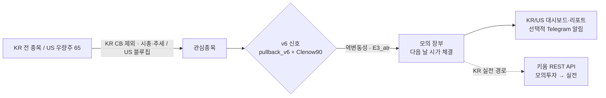
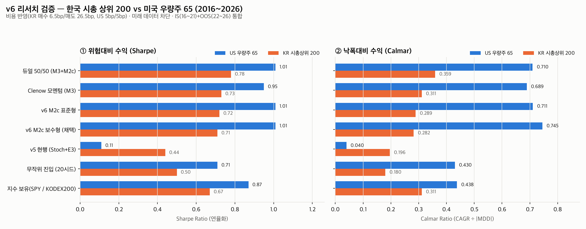
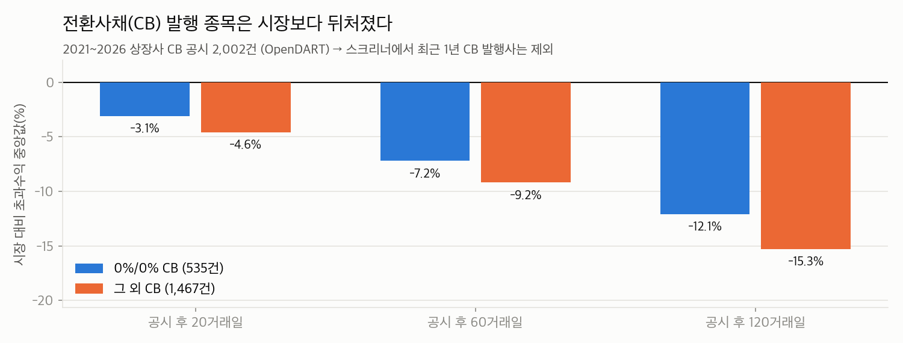

# 📈 Stock Autotrader — 멀티마켓 스윙 자동매매 (v6)

[](https://github.com/Alpha-Crew-Labs/stock-autotrader/actions/workflows/ci.yml)

한국(`KR_Top200`)과 미국 우량주(`US_BlueChip65`)를 **정배열 단기 눌림목(`RSI2 / IBS`) + 모멘텀 품질 순위(`Clenow90`) + 역변동성 비중 조절 + 비대칭 추세·ATR 손절(`E3_atr`)** 로 사고파는 자동매매 시스템.
국내 실전 투자자의 추세·눌림목 원칙에서 출발해 `v5`까지 스토캐스틱을 다듬은 뒤, Reddit `r/algotrading` 실증 스윙/모멘텀 방법론을 통합해 **한국 Top 200 · 미국 우량주 65종목(2016~2026 IS/OOS)** 백테스트와 **20시드 무작위 대조(`Sanity_Random20`)** 로 검증한 **v6(`M2c_v6_보수형`)** 를 기본 전략으로 채택했다.

**▶ [데모 대시보드 보기](https://alpha-crew-labs.github.io/stock-autotrader/)** (2026년 한국 리플레이)


> 장기 정배열(`Close > SMA200 & SMA50 > SMA200`) 종목 중 단기 과매도(`RSI2 < 10` 또는 `IBS < 0.20 & Close < SMA5`)에서 매수하고(▲), 이익 중이면 20일선 이탈까지 추세를 보유하며 손실 중이면 `-2.5*ATR(14)` 또는 200일선 이탈 시 손절한다(▼). 파란 띠가 보유 기간.

---

## 매매 규칙 — v6 (`M2c_v6_보수형`: RSI2/IBS + Clenow90 + 역변동성 + E3_atr)

| | 규칙 (`config.json` 기본값) |
|---|---|
| **매수 (`pullback_v6`)** | `Close > SMA200 & SMA50 > SMA200` 정배열 종목이 `RSI(2) < 10` 또는 `(IBS < 0.20 & Close < SMA5)` 단기 눌림목일 때 다음 날 시가 매수 |
| **후보 순위 (`clenow`)** | 빈 슬롯보다 후보가 많으면 **90일 로그회귀 기울기 × $R^2$ (`Clenow90`)** 높은 매끄러운 추세 종목 우선 배정 |
| **포지션 사이징 (`inverse_vol`)** | `배정금 = 계좌평가 × target_risk(0.016) / max(VOL20, 0.10)`, 단건 상한 `max_pos_weight(0.10 = 10%)` (변동성 큰 종목 비중 축소, 1회 완결) |
| **매도 (`E3_atr`)** | **이익 중이면** 20일선 위 안착 후 종가 20일선 이탈 시 추세 청산 · **손실 중이면** 진입가 `-2.5*ATR(14)` 또는 `SMA200` 이탈 시 즉시 손절 |
| **시장·유니버스 필터** | **KR**: `KODEX 200 > 200일선` (최근 1년 CB 발행사 제외) · **US**: `SPY > 200일선` (`us_bluechips.csv` 65개 대형주) |
| **레거시·옵션 전환** | `config.json`에서 v5(`entry_mode="stoch_v5"`, `exit_mode="E3"`, `rank_by="rs60"`, `sizing="equal_units"`) 또는 표준형 `M2c`(`0.025 / 0.15`) 전환 가능 |

## 어떻게 돌아가나



| 시각 (평일) | 실행 | 하는 일 |
|---|---|---|
| 08:40 | `run_orders.cmd` / `.sh` | 어제 만든 KR 대기주문을 증권사로 전송 (만료 주문·가격 오류 격리, paper 모드는 무동작) |
| 16:10 | `run_daily.cmd` / `.sh` | KR 스크리닝 → 잔고·체결 반영 → v6 신호 → 내일 주문 → 대시보드 (`--market US` 별도 실행 지원) |

## 실전 투입 — 3단계 + 안전장치

`config.json`의 `mode` 하나로 단계를 올린다. 자세히는 **[OPERATIONS.md](OPERATIONS.md)**.

| 단계 | mode | 내용 |
|---|---|---|
| ① 모의 장부 | `paper` | 장부에만 기록 (현재 KR · US 모두 지원) |
| ② 키움 모의투자 | `mock` | KR 전용 키움 모의 서버 주문, 읽기 전용 브로커로 잔고 맞춤 |
| ③ 실전 | `live` | `live.enabled=true` + `--live` **이중 잠금** (KR 전용) |

🛡️ 1건·하루 주문 한도 · 하루 -3% / 고점 대비 -15% 손실 시 `KILL_SWITCH` 자동 생성(주문 중지) · **같은 날 재실행 중복 주문 방지** · **만료(3영업일 초과) 매수 대기주문 자동 차단** · **오후 장부 맞춤은 읽기 전용 브로커(`read_only=True`)** · **보유종목 일시 시세 오류 시 직전가로 평가 유지(거짓 손실한도 방지)** · **원자적 JSON 저장** · **진입가/ATR 손절 추적** · 테스트(CI) 152건으로 전체 흐름 검증

## 같이 고치기
공동 작업자가 각자 AI 코딩 도구로 고친다. 작업 규칙은 [`AGENTS.md`](AGENTS.md) (`CLAUDE.md`는 `@AGENTS.md` 연결). 작업 순서는 [`CONTRIBUTING.md`](CONTRIBUTING.md) — 브랜치 → 백테스트 근거 → 테스트 통과 → PR.

## 검증 결과

### v1~v5 기초 연구


- 유튜브 **"승률 99%"** RSI+MACD+스토캐스틱 5분봉 기법 → 실제 승률 31~38%, 수익팩터 0.50 (거래할수록 손실)
- **v5(`E3 + RS60 + 3분할`)** 로 스토캐스틱을 개선해 한국 Top 200 OOS PF를 `1.02 → 1.39`로 끌어올렸으나, 미국 우량주에서는 투자비중 `4.4%` · CAGR `+0.14%`(OOS `-0.39%`)로 심각한 현금 대기가 드러남

### v6 고도화 검증 — 한국 Top 200 · 미국 우량주 65종목 IS/OOS (`backtest_research_v6.py`)

자세한 방법론·전체 전략군 비교·해석은 **[RESEARCH_V6.md](RESEARCH_V6.md)** 참고.




| 시장 | 전략 | 전체 CAGR | 전체 MDD | 전체 Sharpe | 전체 Calmar | 투자비중 | 거래수 / 승률 / PF | OOS(22~26) CAGR / MDD / PF |
|---|---|---:|---:|---:|---:|---:|---|---:|
| **KR Top 200** | `M0_v5_현행` | 2.23% | -11.4% | 0.44 | 0.196 | 10.0% | 648 / 38.1% / 1.42 | +2.89% / -11.4% / 1.39 |
| **KR Top 200** | **`M2c_v6_보수형` (채택)** | **5.04%** | **-17.9%** | **0.71** | **0.282** | **21.9%** | **815 / 59.9% / 1.56** | **+8.27% / -12.2% / 1.73** |
| KR Top 200 | `M4_Dual50_M2c` (참고) | 9.21% | -25.7% | 0.78 | 0.359 | 32.5% | 1311 / 51.0% / 1.95 | +15.16% / -25.7% / 2.41 |
| KR Top 200 | `Sanity_Random20` (대조군) | 4.77% | -27.68% | 0.50 | 0.180 | 38.66% | 1490.2 / 47.79% / 1.22 | +7.84% / -15.52% / 1.26 |
| **US BlueChip 65** | `M0_v5_현행` | 0.14% | -3.5% | 0.11 | 0.040 | 4.4% | 309 / 42.1% / 1.11 | -0.39% / -2.9% / 0.81 |
| **US BlueChip 65** | **`M2c_v6_보수형` (채택)** | **9.39%** | **-12.6%** | **1.01** | **0.745** | **59.3%** | **1186 / 61.2% / 1.69** | **+5.59% / -14.5% / 1.31** |
| US BlueChip 65 | `M2c` 표준형 (`0.025/0.15`) | 13.42% | -18.9% | 1.01 | 0.711 | 79.7% | 1181 / 60.6% / 1.65 | +5.92% / -21.9% / 1.25 |
| US BlueChip 65 | `Sanity_Random20` (대조군) | 7.01% | -16.89% | 0.71 | 0.430 | 65.07% | 1672.15 / 55.38% / 1.31 | +2.61% / -13.53% / 1.13 |

- **채택 근거**: `M2c_v6_보수형`(`target_risk=0.016, max_pos_weight=0.10`)은 무작위 대조군(`Sanity_Random20`) 대비 양 시장에서 Sharpe·Calmar·PF 모두 앞섰고, US MDD `-12.6%`(OOS `-14.5%`) · KR OOS MDD `-12.2%`로 계좌 운영 한도(`-15.0%`) 안에 들어가면서 **미국 전체 전략 중 Calmar 최고(`0.745`)** 를 기록했다.

### 2026년 한국·미국 리플레이 (미래 데이터 차단 검증)


- **한국 2026년 리플레이 (`2026-01-02 ~ 2026-11-12`, 211거래일, `universe200.csv` 상위 50종목)**: 평가자산 **10,440,758.65원 (`+4.41%`)**, 청산 91건, 승률 **58%**, 거래당 평균 **`+2.38%`** (가을 하락장에서 시장 필터 OFF로 전량 현금 방어 · v5 대비 `-1.64% → +4.41%` 개선).
- **미국 2026년 리플레이 (`2026-01-02 ~ 2026-11-13`, 219거래일, `us_bluechips.csv` 65종목)**: 평가자산 **`$102,745.15` (`+2.75%`)**, 현금 `$32,688.51`, 보유 10종목, 청산 91건, 승률 **55%**, 평균 `-0.36%`.

### 전환사채(CB) 낸 종목은 피한다


OpenDART 2021~2026 상장사 CB 공시 2,002건을 추적 — 공시 후 120일 동안 **70%가 시장보다 부진**. 한국 관심종목에서 제외한다.

## 솔직한 평가

- ✅ **한국·미국 우량주 동시 검증 및 현금 대기 대폭 해소** — US CAGR `0.14% → 9.39%` (Sharpe `1.01`, Calmar `0.745`), KR CAGR `2.23% → 5.04%` (OOS CAGR `8.27%`, PF `1.73`)
- ✅ **무작위 진입 대조군(`Sanity_Random20`) 상회 및 `-15%` 손실한도 정합성 확보**
- ⚠️ **생존 편향 & 추세 랠리 언더퍼폼 가능** — 현 시점 대형주/우량주 기준이며, 강세 랠리에서는 방어적 현금 비중과 `-15%` 한도 제약으로 지수 대비 수익률이 낮을 수 있다
- 👉 수익은 결국 **종목 유니버스·리스크 규율**에서 — 시스템은 신호·비중·손절·안전장치를 일관되게 집행

## 파일

| 파일 | 역할 |
|---|---|
| `strategy.py` | **단일 진실 공급원** — `RSI2`·`IBS`·`SMA`·`VOL20`·`Clenow90`·`Stoch`·진입/청산/사이징/순위 |
| `market_data.py` | KR(`FinanceDataReader`) + US(`yfinance`) 공용 시세 로더 (재시도·캐시·증분 갱신) |
| `us_bluechips.csv` | 미국 S&P 100 등 11개 섹터 우량주 65종목 기본 유니버스 |
| `notify.py` | 선택적 Telegram 일일/주문 알림 (`config.local.json` 설정 시만 동작) |
| `run_daily.py` · `.cmd` · `.sh` | 오후 실행 (`--market KR|US`, 체결·잔고 맞춤 → v6 신호 → 주문 → 대시보드, `--check` 진단) |
| `run_orders.py` · `.cmd` · `.sh` | 아침 KR 주문 전송 (한도·`KILL_SWITCH`·만료차단·오류격리·중복방지) |
| `config.json` · `settings.py` · `broker.py` | 운영 설정(`strategy` 포함)·검증·원자적 저장·안전장치·브로커(읽기전용 분리) |
| `tests/` · `.github/workflows/ci.yml` | 테스트 152건 (미래 데이터 차단, v5/v6 지표·사이징·청산·순위, 멱등성·안전장치, 대시보드) |
| [`RESEARCH_V6.md`](RESEARCH_V6.md) | v6 Reddit 방법론 리서치, KR/US Full·IS·OOS 비교 및 Random20 검증 보고서 |
| [`AGENTS.md`](AGENTS.md) · [`OPERATIONS.md`](OPERATIONS.md) · [`CONTRIBUTING.md`](CONTRIBUTING.md) | AI 작업 규칙 · 실전 운영 · 협업 |
| `screener.py` · `dashboard.py` · `replay.py` | KR 관심종목 스크리닝 · KR/US HTML 대시보드 · 미래 차단 리플레이 검증 |
| `kiwoom_client.py` | 키움 REST API (KR 전용, 기본 모의 서버, 실전 주문 이중 차단) |
| `backtest_research_v6.py` · `backtest*.py` | v6 한/미 통합 리서치 및 v1~v5 백테스트 스크립트 |
| `cb_event_study.py` · `make_figures.py` | 전환사채 사건 연구 · README 그림 및 Pages 데모 대시보드 생성 |
| [`프로젝트_설명.md`](프로젝트_설명.md) | 자세한 설명 (규칙 대조표, 판단 기준, 다음 단계) |

## 실행

```bash
pip install -r requirements.txt
python -m pytest -q
# config.local.json (커밋 금지): {"dart_api_key": "...", "kiwoom_mock_appkey": "...", ...} → OPERATIONS.md
python run_daily.py --check                    # KR 설정·장부·안전장치 읽기 전용 점검
python run_daily.py --market US --check        # US 설정·장부 읽기 전용 점검
python screener.py && python run_daily.py      # KR 오후 실행 (또는 ./run_daily.sh / run_daily.cmd)
python run_daily.py --market US                # US 모의 장부 실행 (state/paper_us.json)
python replay.py 2026-01-02 --market US        # US 2026년 리플레이
python run_orders.py --dry-run                 # KR 아침 주문 계획 미리보기
```

> ⚠️ 개인 연구 프로젝트입니다. 투자 권유가 아니며, 백테스트는 생존 편향(현재 시점 대형주/우량주 선정)이 있습니다.
