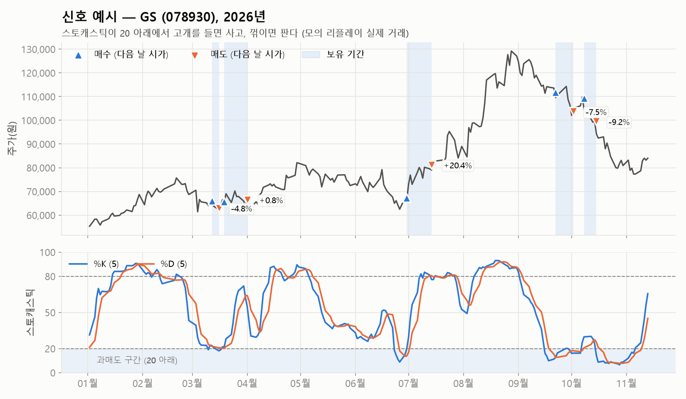
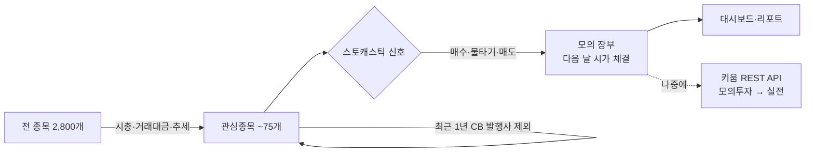
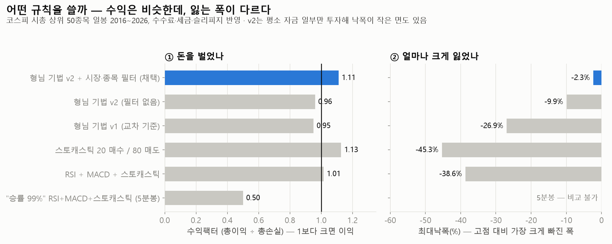
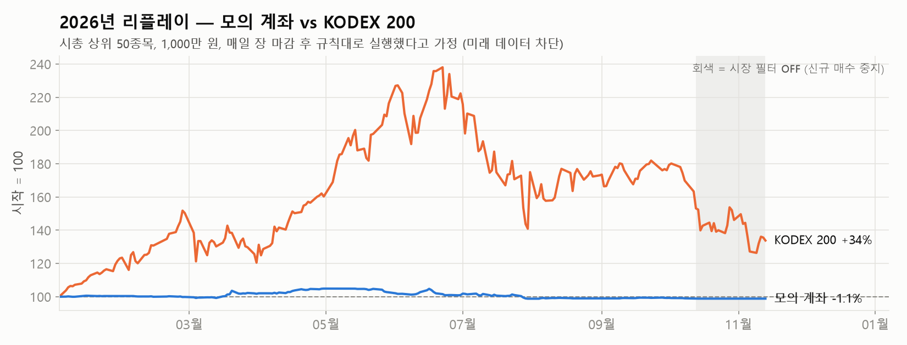
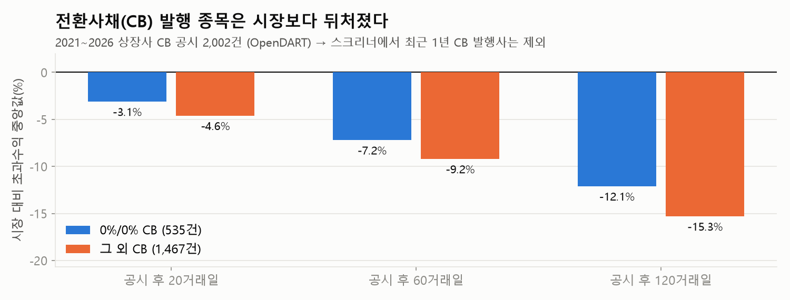

# 📈 Stock Autotrader — 스토캐스틱 일봉 자동매매

국내주식을 **스토캐스틱 하나로** 사고파는 자동매매 시스템.
"최대한 잃지 말자"는 한 실전 투자자(형님)의 매매법을 규칙으로 옮기고, 10년 데이터로 검증한 뒤 **모의 장부**로 매일 돌린다.

**▶ [데모 대시보드 보기](https://alpha-crew-labs.github.io/stock-autotrader/)** (2026년 리플레이)



> 스토캐스틱이 20 아래에서 고개를 들면 사고(▲), 꺾이면 판다(▼). 파란 띠가 보유 기간.

---

## 매매 규칙 — 스토캐스틱 (14, 5, 5)

| | 규칙 |
|---|---|
| **매수** | 20 아래로 내려갔다가 %K·%D 간격이 3일 연속 좁아지며 %K가 고개를 들 때(교차 예상) 또는 골든크로스 |
| **물타기** | 보유 중 20 아래에서 두 선이 다시 벌어지면 추가 매수 (최대 3회) |
| **매도** | 데드크로스가 예상되거나 발생하면 전량 — 80까지 안 가도 판다 (원금 지키기) |
| **필터** | 하락장(KODEX200 < 200일선)이면 신규 매수 쉼 · 200일선 위 + 6개월 상승 종목만 |

## 어떻게 돌아가나



매일 장 마감 후 `run_daily.cmd` 한 번 → 스크리닝 → 신호 → 모의 체결 → [대시보드](https://alpha-crew-labs.github.io/stock-autotrader/) 갱신.

## 검증 결과

### 어떤 규칙을 쓸까


- 유튜브 **"승률 99%"** RSI+MACD+스토캐스틱 5분봉 기법 → 실제 승률 31~38%, 수익팩터 0.50 (거래할수록 손실)
- 지표를 섞어도(RSI·MACD) 좋아지지 않음 — RSI는 스토캐스틱과 거의 같은 신호
- 스토캐스틱 규칙들은 **수익은 비슷(본전 근처)**, 차이는 **잃는 폭**

### 2026년 리플레이 — 모의 계좌 vs 시장


### 전환사채(CB) 낸 종목은 피한다


OpenDART 2021~2026 상장사 CB 공시 2,002건을 추적 — 공시 후 120일 동안 **70%가 시장보다 부진**. 그래서 관심종목에서 뺀다.

## 솔직한 평가

- ✅ **크게 안 잃는다** — 최대낙폭 -2% (그냥 보유 -45%)
- ⚠️ **수익도 작다** — 연 +0.1%. 자금 대부분이 쉬고, 상승 추세에서 일찍 판다 (위 GS 예시: +20% 매도 후 +60% 더 오름)
- ⚠️ **손절이 없다** — 급락장에서 한 종목 -30%도 나옴
- 👉 수익은 결국 **종목 고르는 눈**에서 — 시스템은 타이밍·기록·감시 담당

## 파일

| 파일 | 역할 |
|---|---|
| `run_daily.py` · `run_daily.cmd` | 매일 실행 (신호 → 모의 장부 → 리포트·대시보드) |
| `screener.py` | 관심종목 스크리닝 (CB 발행사 제외) |
| `dashboard.py` | 대시보드 HTML |
| `replay.py` | 과거 날짜 리플레이 검증 (미래 데이터 차단) |
| `kiwoom_client.py` | 키움 REST API (기본 모의 서버, 실전 주문 차단) |
| `backtest*.py` | 백테스트 (일봉 10년 · 5분봉 60일) |
| `cb_event_study.py` | 0% 전환사채 사건 연구 (OpenDART) |
| `make_figures.py` | 이 README의 그림 |
| [`프로젝트_설명.md`](프로젝트_설명.md) | 자세한 설명 (규칙 대조표, 판단 기준, 다음 단계) |

## 실행

```bash
pip install pandas numpy finance-datareader yfinance matplotlib requests tabulate
# config.local.json  (커밋 금지): {"dart_api_key": "..."}
python screener.py && python run_daily.py
```

> ⚠️ 개인 연구 프로젝트입니다. 투자 권유가 아니며, 백테스트는 생존 편향(현재 시총 상위 종목으로 선정)이 있습니다.
