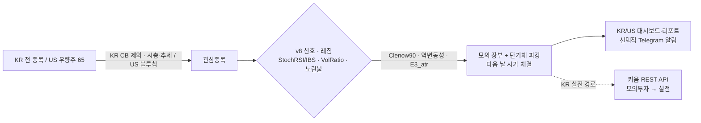
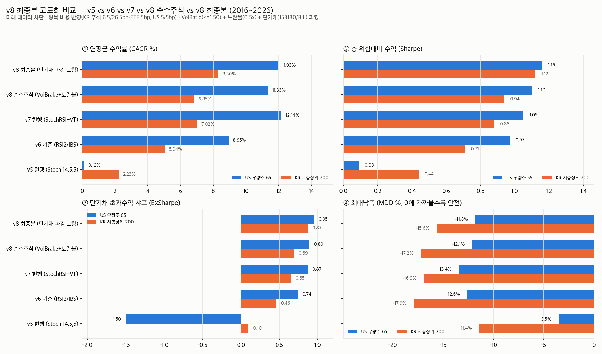
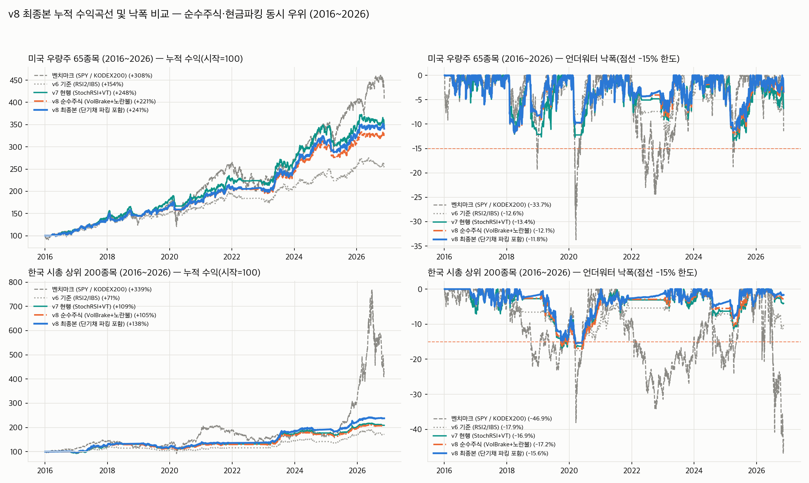

# 📈 Stock Autotrader — 멀티마켓 스윙 자동매매 (v8 최종본)

한국(`KR_Top200`)과 미국 우량주(`US_BlueChip65`)를 **`StochRSI + IBS` 단기 눌림목 + 대량 투매 제외(`~VOL_SPIKE_DN`) + `Clenow90` 추세 품질 순위 + `Market Regime`(변동성 타게팅 + `VolRatio` 크래시 브레이크 + 노란불 감속) + 비대칭 손절(`E3_atr`) + 단기채 유휴현금 파킹(`153130`/`BIL`)** 으로 사고파는 자동매매 시스템.
유튜브 5분봉(`RSI+MACD+스토캐스틱`) 아이디어에서 출발해 Reddit(`r/algotrading`, `r/quant`) 최신 기법 10여 종을 추가 검증하고, **한·미 10년 IS/OOS · 2배 비용 스트레스 · 1,000회 Monte Carlo · 20시드 무작위 대조(`Sanity_Random20`)** 로 검증한 **`v8 최종본` (`V8b`)** 을 기본 전략으로 채택했다.

**▶ [데모 대시보드 보기](https://alpha-crew-labs.github.io/stock-autotrader/)** (2026년 한국 리플레이)

> 장기 정배열(`Close > SMA200 & SMA50 > SMA200`) 종목 중 투매 거래량 급증을 피한 단기 과매도(`StochRSI < 15` 또는 `IBS < 0.20 & Close < SMA5`)에서 매수하고(▲), 시장 변동성 급등(`Vol20/Vol60 > 1.50`) 시 신규 진입 정지 · 50일선 아래 조정장(노란불)에선 비중 절반(`0.5x`)으로 자동 감속한다. 유휴현금은 단기채 ETF(`153130`/`BIL`)에 자동 파킹하고, 주식 매수 시 필요한 만큼만 즉시 인출한다.

---

## 매매 규칙 — `v8 최종본` (`V8b`: v7 시그널 + v8 레짐/현금파킹)

| | 규칙 (`config.json` 기본값) |
|---|---|
| **매수 (`pullback_v7`)** | `Close > SMA200 & SMA50 > SMA200` 정배열 종목이 `StochRSI(14,14,3,3) < 15` 또는 `(IBS < 0.20 & Close < SMA5)` 이고 `~VOL_SPIKE_DN`(하락 + 20일 평균 거래량 2.5배 초과)이 아닐 때 다음 날 시가 매수 |
| **후보 순위 (`clenow`)** | 빈 슬롯보다 후보가 많으면 **90일 로그회귀 기울기 × $R^2$ (`Clenow90`)** 높은 매끄러운 추세 종목 우선 배정 |
| **시장 레짐 (`market_regime`)** | ① 벤치마크 ≤ `SMA200`: `OFF`(매수 중지) ② `Vol20 / Vol60 > 1.50`: `BRAKE`(크래시 브레이크, 신규 매수 중지) ③ `SMA200 < 벤치마크 ≤ SMA50`: `YELLOW(0.5x)`(노란불, 비중 절반 감속) ④ 변동성 타게팅(`0.35~1.25x`) |
| **포지션 사이징 (`inverse_vol`)** | `배정금 = 계좌평가 × target_risk(0.018) × regime_scale / max(VOL20, 0.10)` (단건 상한 `max_pos_weight=11%`) |
| **매도 (`E3_atr`)** | **이익 중이면** 20일선 위 안착 후 종가 20일선 이탈 시 추세 청산 · **손실 중이면** 진입가 `-2.5*ATR(14)` 또는 `SMA200` 이탈 시 즉시 손절 |
| **유휴현금 파킹 (`cash_park`)** | **KR `153130` / US `BIL`** — 2% 버퍼·5% 데드밴드로 `paper`/`replay` 모의 장부 내 유휴현금 자동 파킹(주식 매수 시 시가 선매도, `positions`/`history`와 분리) |
| **시장·유니버스 필터** | **KR**: `KODEX 200` (최근 1년 CB 발행사 제외) · **US**: `SPY` (`us_bluechips.csv` 65개 대형주) |
| **레거시 전환** | `config.json`에서 v7(`vol_ratio_brake=null, yellow_light_mult=1.0, cash_park=false`), v6(`pullback_v6`), v5(`stoch_v5`)로 즉시 전환 가능 |

## 어떻게 돌아가나

| 시각 (평일) | 실행 | 하는 일 |
|---|---|---|
| 08:40 | `run_orders.cmd` / `.sh` | 어제 만든 KR 대기주문을 증권사로 전송 (만료 주문·가격 오류 격리, paper 모드는 무동작) |
| 16:10 | `run_daily.cmd` / `.sh` | KR 스크리닝 → 체결·현금파킹 반영 → v8 레짐/신호 → 내일 주문 → 대시보드 (`--market US` 별도 지원) |

## 실전 투입 — 3단계 + 안전장치

`config.json`의 `mode` 하나로 단계를 올린다. 자세히는 **[OPERATIONS.md](OPERATIONS.md)**.

| 단계 | mode | 내용 |
|---|---|---|
| ① 모의 장부 | `paper` | 장부에만 기록 (주식 + 단기채 현금파킹 시뮬레이션, KR · US 모두 지원) |
| ② 키움 모의투자 | `mock` | KR 전용 키움 모의 서버 주문, 읽기 전용 브로커로 잔고 맞춤(현금파킹은 권고 안내) |
| ③ 실전 | `live` | `live.enabled=true` + `--live` **이중 잠금** (KR 전용) |

🛡️ 1건·하루 주문 한도 · 하루 -3% / 고점 대비 -15% 손실 시 `KILL_SWITCH` 자동 생성(주문 중지) · **시장 변동성 타게팅 + `VolRatio(>1.50)` 브레이크 + 노란불 감속** · **같은 날 재실행 중복 주문 방지** · **만료(3영업일 초과) 매수 대기주문 자동 차단** · **오후 장부 맞춤은 읽기 전용 브로커** · **원자적 JSON 저장** · **진입가/ATR 손절 추적** · 테스트(CI) 173건 검증

## 검증 결과

### v5 → v6 → v7 → v8 최종본 진화 (`backtest_research_v8.py`)

전체 어블레이션(기각된 10여 개 기법 포함) · 2배 비용 스트레스 · 연도별(2016~2026) · 1,000회 Monte Carlo 검증 상세는 **[RESEARCH_V8.md](RESEARCH_V8.md)** ([RESEARCH_V7.md](RESEARCH_V7.md), [RESEARCH_V6.md](RESEARCH_V6.md)) 참고.

| 시장 | 전략 | 전체 CAGR / MDD | Sharpe / Calmar / ExSharpe | 승률 / PF | OOS(22~26) CAGR / MDD / Sh / ExSh | 2x OOS Sh | MC95 MDD |
|---|---|---:|---:|---|---:|---:|---:|
| **KR Top 200** | `M0_v5_현행` | 2.23% / -11.4% | 0.44 / 0.196 / 0.10 | 38.1% / 1.42 | +2.89% / -11.4% / 0.45 / 0.07 | — | — |
| KR Top 200 | `B0_v6_기준` | 5.04% / -17.9% | 0.71 / 0.282 / 0.46 | 59.9% / 1.56 | +8.27% / -12.2% / 1.06 / 0.72 | 0.96 | -13.1% |
| KR Top 200 | `B1_v7_현행` | 7.02% / -16.9% | 0.88 / 0.416 / 0.65 | 62.2% / 1.72 | +9.96% / -11.3% / 1.27 / 0.93 | 1.03 | -12.8% |
| KR Top 200 | `C2` (`v8` 순수주식) | 6.85% / -17.2% | 0.94 / 0.398 / 0.69 | 62.5% / 1.72 | +9.90% / -10.6% / 1.36 / 0.99 | 1.12 | -11.2% |
| **KR Top 200** | **`V8b` (`v8 최종본`)** | **8.30% / -15.6%** | **1.12 / 0.533 / 0.87** | **62.5% / 1.72** | **+12.18% / -8.3% / 1.65 / 1.28** | **1.41** | **-11.2%** |
| KR Top 200 | `Sanity_Random20` | 3.06% / -23.32% | 0.42 / 0.150 / 0.19 | 51.08% / 1.37 | +6.83% / -11.29% / 0.84 / 0.51 | — | — |
| **US BlueChip 65** | `M0_v5_현행` | 0.12% / -3.5% | 0.09 / 0.033 / -1.50 | 41.9% / 1.10 | -0.46% / -2.9% / -0.35 / -3.23 | — | — |
| US BlueChip 65 | `B0_v6_기준` | 8.95% / -12.6% | 0.97 / 0.710 / 0.74 | 61.1% / 1.69 | +4.66% / -14.5% / 0.57 / 0.13 | 0.50 | -9.5% |
| US BlueChip 65 | `B1_v7_현행` | 12.14% / -13.4% | 1.05 / 0.908 / 0.87 | 62.4% / 1.68 | +8.15% / -13.4% / 0.77 / 0.42 | 0.71 | -10.8% |
| US BlueChip 65 | `C2` (`v8` 순수주식) | 11.33% / -12.1% | 1.10 / 0.937 / 0.89 | 62.9% / 1.77 | +8.49% / -12.1% / 0.87 / 0.49 | 0.80 | -9.1% |
| **US BlueChip 65** | **`V8b` (`v8 최종본`)** | **11.93% / -11.8%** | **1.16 / 1.010 / 0.95** | **62.9% / 1.77** | **+9.65% / -11.4% / 0.98 / 0.59** | **0.89** | **-9.1%** |
| US BlueChip 65 | `Sanity_Random20` | 8.07% / -12.87% | 0.88 / 0.660 / 0.65 | 57.48% / 1.58 | +4.61% / -11.63% / 0.54 / 0.12 | — | — |

### 2026년 한국·미국 단년 리플레이 (미래 데이터 차단 검증)

- **한국 2026년 리플레이 (`2026-01-02 ~ 2026-11-12`, 211거래일, `universe200.csv` 상위 50종목)**: 평가자산 **10,587,298.03원 (`+5.87%` · MDD `-4.04%`)**, `153130` 87주(`9,847,965원`) 현금파킹, 청산 61건, 승률 **56%**, 평균 `+1.69%` (`v7 +4.33%` 대비 `+1.54%p` 개선).
- **미국 2026년 리플레이 (`2026-01-02 ~ 2026-11-20`, 224거래일, `us_bluechips.csv` 65종목)**: 평가자산 **`$94,554.54` (`-5.45%` · MDD `-8.85%`)**, `BIL` 903주(`$82,705.77`) 현금파킹, 청산 114건, 승률 **43%**, 평균 `-0.84%` (`v7 -8.94%` / MDD `-12.4%` 대비 `+3.49%p` 손실방어).

### 전환사채(CB) 낸 종목은 피한다

OpenDART 2021~2026 상장사 CB 공시 2,002건을 추적 — 공시 후 120일 동안 **70%가 시장보다 부진**. 한국 관심종목에서 제외한다.

## 파일

| 파일 | 역할 |
|---|---|
| `strategy.py` | **단일 진실 공급원** — `StochRSI`·`IBS`·`VOL_SPIKE_DN`·`market_regime`·`Clenow90`·`Stoch`·진입/청산/사이징 |
| `market_data.py` | KR(`FinanceDataReader`) + US(`yfinance`) 공용 시세 로더 (재시도·캐시·증분 갱신) |
| `us_bluechips.csv` | 미국 S&P 100 등 11개 섹터 우량주 65종목 기본 유니버스 |
| `notify.py` | 선택적 Telegram 일일/주문 알림 (`config.local.json` 설정 시만 동작) |
| `run_daily.py` · `.cmd` · `.sh` | 매일 장 마감 실행 (`--market KR|US`, `v8` 레짐·단기채 현금파킹·신호·주문·대시보드, `--check` 진단) |
| `run_orders.py` · `.cmd` · `.sh` | 아침 KR 주문 전송 (한도·`KILL_SWITCH`·만료차단·오류격리·중복방지) |
| `config.json` · `settings.py` · `broker.py` | 운영 설정(`strategy` 포함)·검증·원자적 저장·안전장치·브로커(읽기전용 분리) |
| `backtest_research_v8.py` · `RESEARCH_V8.md` | **v8 최종 연구 백테스트** (2배 비용·연도별·ExSharpe·MC95) 및 보고서 |
| `tests/` · `.github/workflows/ci.yml` | 테스트 173건 (미래 데이터 차단, v5~v8 지표·레짐·현금파킹·사이징·청산·안전장치, 대시보드) |
