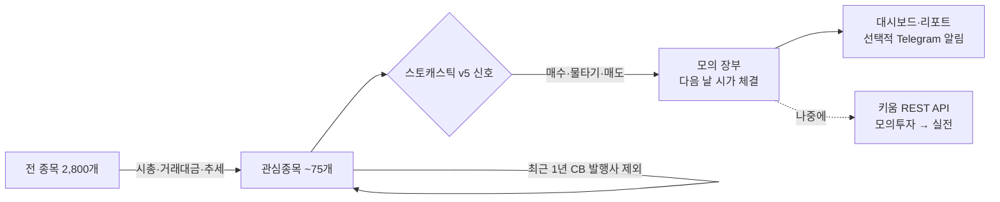
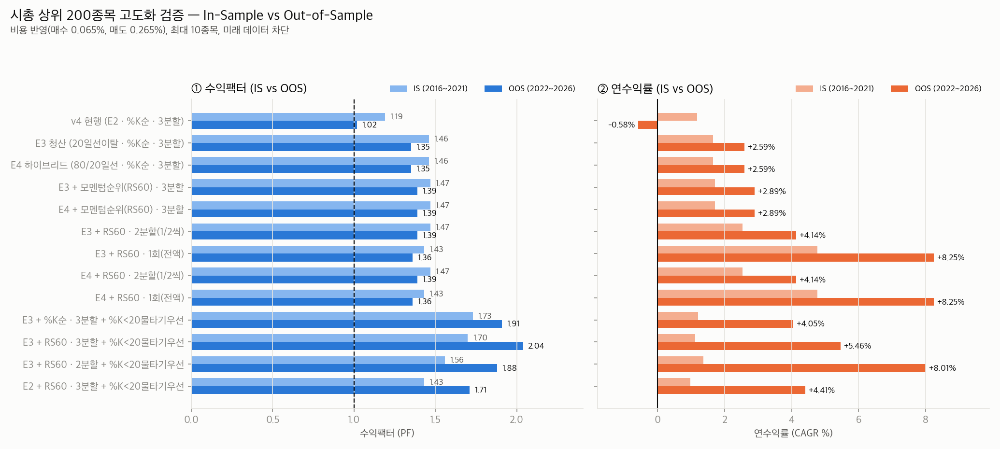
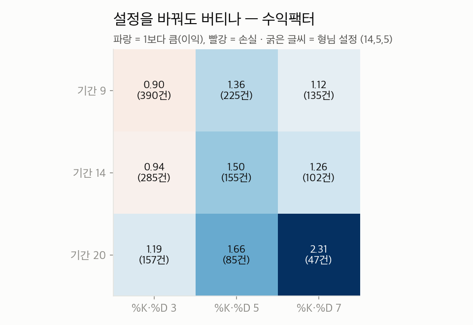
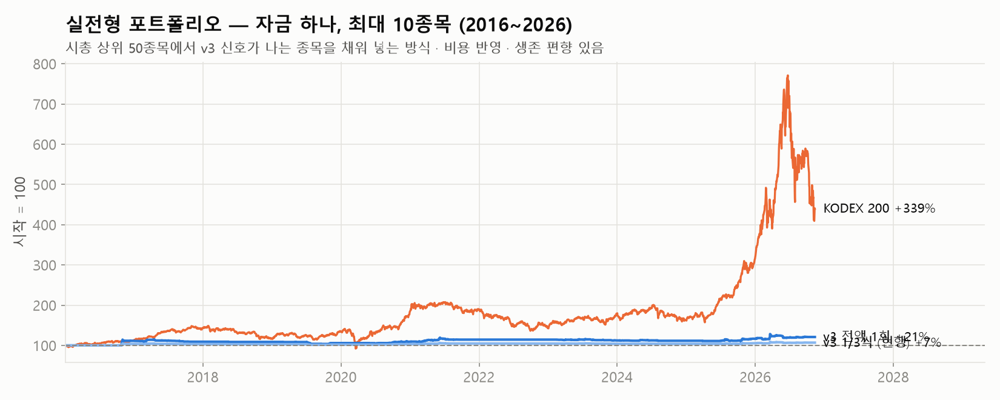

# 📈 Stock Autotrader — 스토캐스틱 일봉 자동매매 (v5)

[](https://github.com/Alpha-Crew-Labs/stock-autotrader/actions/workflows/ci.yml)

국내주식을 **스토캐스틱(14, 5, 5)** 기반으로 사고파는 자동매매 시스템.
"최대한 잃지 말자"는 한 실전 투자자(형님)의 매매법을 규칙으로 옮기고, 10년 시총 상위 200종목 In-Sample / Out-of-Sample 백테스트로 검증한 뒤 **모의 장부**로 매일 돌린다.

**▶ [데모 대시보드 보기](https://alpha-crew-labs.github.io/stock-autotrader/)** (2026년 리플레이)


> 스토캐스틱이 20 아래에서 고개를 들면 사고(▲), 이익 중이면 20일 이동평균선 이탈까지 보유해 추세를 타며 손실 중이면 데드크로스로 빠르게 정리한다(▼). 파란 띠가 보유 기간.

---

## 매매 규칙 — 스토캐스틱 v5 (`E3 + RS60 + 3분할`)

| | 규칙 |
|---|---|
| **매수** | 20 아래로 내려갔다가 %K·%D 간격이 3일 연속 좁아지며 %K가 고개를 들 때(교차 예상) 또는 골든크로스 |
| **후보 순위 (v5)** | 같은 날 매수 후보가 슬롯보다 많으면 **60일 상대강도(`RS60` / 60일 수익률) 높은 순** 우선 배정 (`config.json` `strategy.rank_by`) |
| **물타기** | 보유 중 20 아래에서 두 선이 다시 벌어지면 추가 매수 (최대 3회, 직전 매수 후 5거래일 경과) |
| **매도 (v5 · E3)** | **이익 중이면** 20일선 안착 후 종가 20일선 이탈까지 추세 보유 · **손실 중이면** 데드크로스(예상)에 바로 매도 (`config.json` `strategy.exit_mode`로 E0/E2/E3/E4 전환 가능) |
| **필터** | 하락장(KODEX200 < 200일선)이면 신규 매수 쉼 · 200일선 위 + 6개월 상승 종목만 |
| **주봉 필터 (v3)** | 직전 완성 주봉 스토캐스틱이 올라가는 중(%K > %D)일 때만 일봉 매수 — 큰 흐름과 작은 흐름을 같이 본다 |

## 어떻게 돌아가나



| 시각 (평일) | 실행 | 하는 일 |
|---|---|---|
| 08:40 | `run_orders.cmd` / `.sh` | 어제 만든 대기주문을 증권사로 전송 (만료 주문·가격 오류 격리, paper 모드는 무동작) |
| 16:10 | `run_daily.cmd` / `.sh` | 스크리닝 → 잔고·체결 반영 → v5 신호 → 내일 주문 → [대시보드](https://alpha-crew-labs.github.io/stock-autotrader/) |

## 실전 투입 — 3단계 + 안전장치

`config.json`의 `mode` 하나로 단계를 올린다. 자세히는 **[OPERATIONS.md](OPERATIONS.md)**.

| 단계 | mode | 내용 |
|---|---|---|
| ① 모의 장부 | `paper` | 장부에만 기록 (지금) |
| ② 키움 모의투자 | `mock` | 키움 모의 서버로 진짜 주문, 읽기 전용 브로커로 잔고 맞춤 |
| ③ 실전 | `live` | `live.enabled=true` + `--live` **이중 잠금** |

🛡️ 1건·하루 주문 한도 · 하루 -3% / 고점 대비 -15% 손실 시 `KILL_SWITCH` 자동 생성(주문 중지) · **같은 날 재실행 중복 주문 방지** · **만료(3영업일 초과) 매수 대기주문 자동 차단** · **오후 장부 맞춤은 읽기 전용 브로커(`read_only=True`)** · **보유종목 일시 시세 오류 시 직전가로 평가 유지(거짓 손실한도 방지)** · **원자적 JSON 저장** · 매도는 증권사 잔고 기준 · 테스트(CI)로 전체 흐름 검증

## 같이 고치기
공동 작업자가 각자 AI 코딩 도구로 고친다. 작업 규칙은 [`AGENTS.md`](AGENTS.md) (`CLAUDE.md`는 `@AGENTS.md` 연결). 작업 순서는 [`CONTRIBUTING.md`](CONTRIBUTING.md) — 브랜치 → 백테스트 근거 → 테스트 통과 → PR.

## 검증 결과

### 어떤 규칙을 쓸까 (v1~v3)


- 유튜브 **"승률 99%"** RSI+MACD+스토캐스틱 5분봉 기법 → 실제 승률 31~38%, 수익팩터 0.50 (거래할수록 손실)
- 지표를 섞어도(RSI·MACD) 좋아지지 않음 — RSI는 스토캐스틱과 거의 같은 신호
- **주봉 스토캐스틱 필터(v3)** 를 더하자 일봉 거래당 수익과 수익팩터가 개선됨

### v5 고도화 검증 — 실제 시총 상위 200종목 IS / OOS (`backtest_upgrade.py`)
기존 `data/universe.csv`가 시총 상위 50이 아니라 알파벳 A~H순 50종목으로 편중되어 있었음을 확인(`backtest.py` `Marcap` 수치 정렬 보완), **실제 시총 상위 200종목(`data/universe200.csv`)** 을 **In-Sample(2016~2021)** 과 **Out-of-Sample(2022~2026)** 로 분할 검증했다(비용: 매수 0.065% · 매도 0.265%, 최대 10종목, 미래 데이터 차단).



| 전략 조합 | 전체 CAGR | 전체 MDD | 전체 Calmar | 전체 PF | IS(16~21) CAGR / PF | OOS(22~26) CAGR / PF | 비고 |
|---|---|---|---|---|---|---|---|
| v4 현행 (`E2 · %K순 · 3분할`) | +0.39% | -11.3% | 0.034 | 1.08 | +1.18% / 1.19 | -0.58% / 1.02 | OOS 수익 악화 |
| `E3 · %K순 · 3분할` | +2.07% | -11.9% | 0.174 | 1.39 | +1.66% / 1.46 | +2.59% / 1.35 | IS·OOS 개선 |
| **v5 채택 (`E3 · RS60 · 3분할`)** | **+2.23%** | **-11.4%** | **0.196** | **1.42** | **+1.71% / 1.47** | **+2.89% / 1.39** | **OOS Calmar 최고 · 채택** |
| `E3 · RS60 · 2분할(1/2씩)` | +3.25% | -16.6% | 0.196 | 1.42 | +2.54% / 1.47 | +4.14% / 1.39 | MDD -15% 한도 초과 우려 |
| `E3 · RS60 · 3분할 + %K<20물타기우선` | +3.04% | -13.6% | 0.224 | 1.91 | +1.12% / 1.70 | +5.46% / 2.04 | IS CAGR 하락으로 옵션 유지 |

- **v5 채택 근거**: `E3(이익 중 20일선 이탈까지 추세 추종)` + `RS60(강한 모멘텀 우선)` + `3분할`은 IS·OOS 양쪽에서 모두 v4 대비 PF·CAGR이 크게 개선되었고(거래 648건, 승률 38.1%, 거래당 +1.27%), MDD `-11.4%`가 운영 손실 한도(`-15.0%`) 안에 안정적으로 들어온다.
- `%K < 20` 구간 물타기 우선권(`hold_add_under20=True`)은 OOS에서 PF 2.04로 강했으나 IS CAGR이 기준선보다 낮아 기본값은 `false`로 두고 `config.json` 옵션으로 열어두었다.

### 설정을 바꿔도 버티나


%K·%D 평활 5 이상이면 대부분 이익, 3이면 손실. 형님 설정 (14,5,5)는 운 좋은 한 점이 아니라 **안정적인 구간 안**에 있다.

### 실전형 포트폴리오 & 2026년 리플레이



- **2026년 리플레이 (`2026-01-02 ~ 2026-11-12`, 시총 상위 50종목, v5)**: 평가자산 9,835,709원 (`-1.64%`), 청산 24건, 승률 25%, 평균 `-2.76%` (같은 기간 KODEX 200 `+36%`, 가을 급락장 최대낙폭 방어). 시총 상위 200종목 전체 기준 2026년 단년 리플레이는 v5 `-4.05%` / v4 `-2.45%`로, 단기 급락 연도에는 보수적으로 현금 비중을 유지한다.

### 전환사채(CB) 낸 종목은 피한다


OpenDART 2021~2026 상장사 CB 공시 2,002건을 추적 — 공시 후 120일 동안 **70%가 시장보다 부진**. 그래서 관심종목에서 뺀다.

## 솔직한 평가

- ✅ **10년 IS·OOS 검증에서 일관된 개선** — v4(OOS CAGR -0.58%, PF 1.02) 대비 v5(OOS CAGR +2.89%, PF 1.39, 전체 Calmar 0.034 → 0.196)
- ✅ **안정적인 낙폭 제어** — 전체 MDD `-11.4%` (KODEX200 `-47%`)
- ⚠️ **낮은 평균 투자비중(~10%)** — 하락장 필터와 주봉 필터로 자금 대부분이 현금으로 대기한다
- ⚠️ **단기 급락 연도 손실 가능** — 손절 라인 없이 종가 신호로 대응해 2026년 급락장 리플레이에서는 소폭 마이너스(`-1.64%`) 기록
- 👉 수익은 결국 **종목 고르는 눈**에서 — 시스템은 타이밍·기록·감시·안전장치 담당

## 파일

| 파일 | 역할 |
|---|---|
| `strategy.py` | **단일 진실 공급원** — 스토캐스틱·추세·주봉·청산(`evaluate_position`)·순위(`rank_candidates`) |
| `market_data.py` | 공용 시세 로더 (재시도·당일 캐시·증분 갱신) |
| `notify.py` | 선택적 Telegram 일일/주문 알림 (`config.local.json` 설정 시만 동작) |
| `run_daily.py` · `.cmd` · `.sh` | 오후 실행 (체결·잔고 맞춤 → v5 신호 → 대기주문 → 리포트·대시보드, `--check` 진단) |
| `run_orders.py` · `.cmd` · `.sh` | 아침 주문 전송 (한도·KILL_SWITCH·만료차단·오류격리·중복방지) |
| `config.json` · `settings.py` · `broker.py` | 운영 설정(`strategy` 포함)·원자적 저장·안전장치·증권사 계층(읽기전용 분리) |
| `tests/` · `.github/workflows/ci.yml` | 테스트 138건 (미래 데이터 차단, v5 규칙, 멱등성·격리·안전장치, 대시보드) |
| [`AGENTS.md`](AGENTS.md) · [`OPERATIONS.md`](OPERATIONS.md) · [`CONTRIBUTING.md`](CONTRIBUTING.md) | AI 작업 규칙 · 실전 운영 · 협업 |
| `screener.py` | 관심종목 스크리닝 (CB 발행사 제외, DART 장애 시 캐시 폴백) |
| `dashboard.py` | 고도화 대시보드 HTML (초과수익·MDD 언더워터 차트·매수 임박 레이더·청산사유) |
| `replay.py` | 과거 날짜 리플레이 검증 (미래 데이터 차단) |
| `kiwoom_client.py` | 키움 REST API (기본 모의 서버, 실전 주문 이중 차단) |
| `backtest_upgrade.py` · `backtest*.py` | v5 IS/OOS 검증 및 과거 10년·5분봉·청산 비교 백테스트 |
| `cb_event_study.py` | 0% 전환사채 사건 연구 (OpenDART) |
| `make_figures.py` | README 그림·Pages 데모 대시보드 생성 |
| [`프로젝트_설명.md`](프로젝트_설명.md) | 자세한 설명 (규칙 대조표, 판단 기준, 다음 단계) |

## 실행

```bash
pip install -r requirements.txt
python -m pytest -q
# config.local.json (커밋 금지): {"dart_api_key": "...", "kiwoom_mock_appkey": "...", ...} → OPERATIONS.md
python run_daily.py --check                    # 설정·장부·안전장치 읽기 전용 점검
python screener.py && python run_daily.py      # 오후 (또는 ./run_daily.sh / run_daily.cmd)
python run_orders.py --dry-run                 # 아침 주문 계획 미리보기
```

> ⚠️ 개인 연구 프로젝트입니다. 투자 권유가 아니며, 백테스트는 생존 편향(현재 시총 상위 종목으로 선정)이 있습니다.
