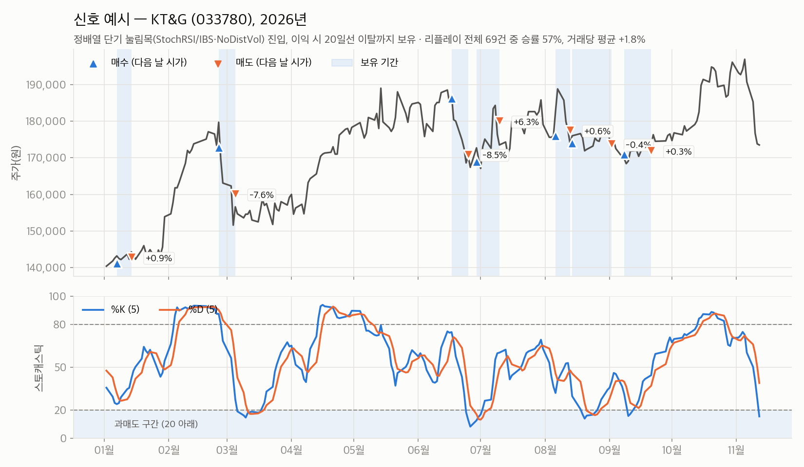
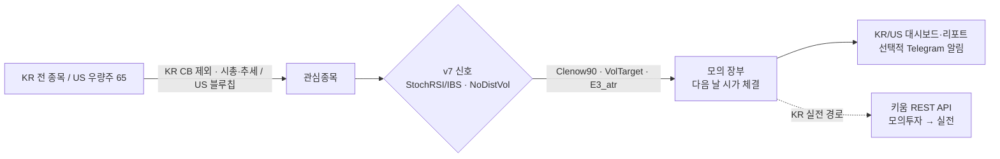
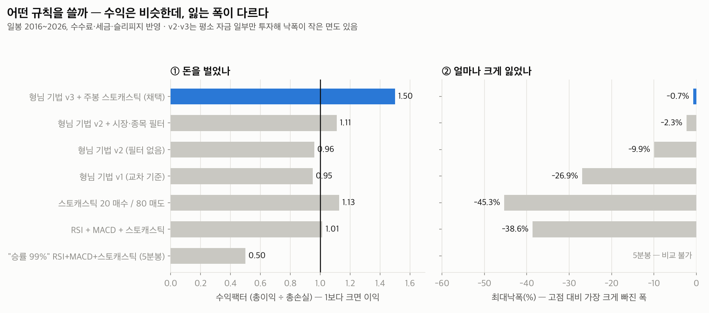
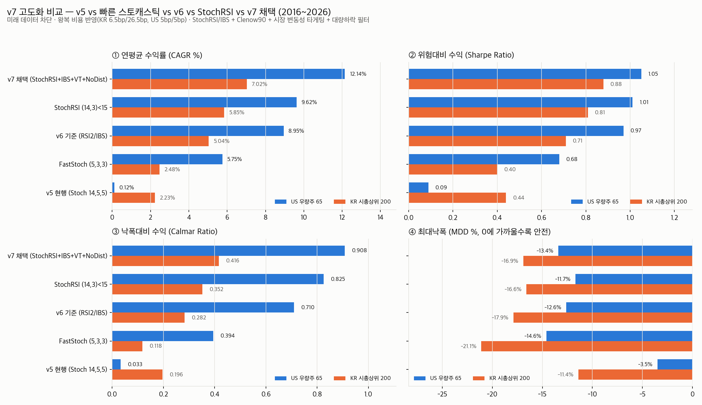
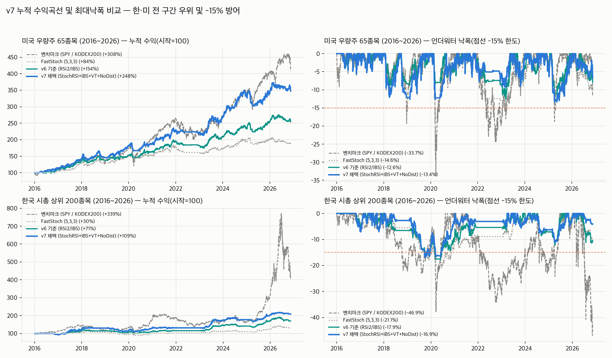
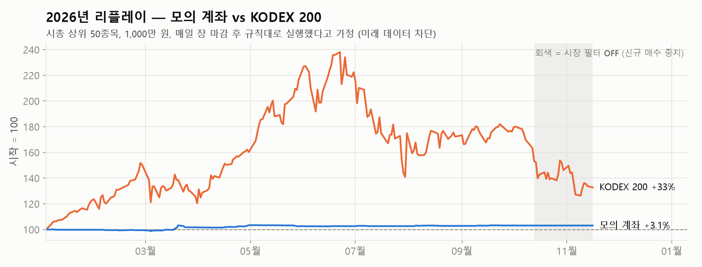

# 📈 Stock Autotrader — 멀티마켓 스윙 자동매매 (v7)

[](https://github.com/Alpha-Crew-Labs/stock-autotrader/actions/workflows/ci.yml)

한국(`KR_Top200`)과 미국 우량주(`US_BlueChip65`)를 **`StochRSI + IBS` 단기 눌림목 + 대량 거래량 투매 제외(`~VOL_SPIKE_DN`) + 모멘텀 품질 순위(`Clenow90`) + 역변동성·시장 변동성 타게팅(`VolTarget`) + 비대칭 추세·ATR 손절(`E3_atr`)** 로 사고파는 자동매매 시스템.
유튜브 5분봉(`RSI+MACD+스토캐스틱`) 아이디어와 국내 추세 눌림목 원칙에서 출발해, Reddit(`r/algotrading`)·정량 연구 컨센서스를 **한국 Top 200 · 미국 우량주 65종목(2016~2026 IS/OOS)**, **7점 파라미터 안정성 고원(Plateau)**, **1,000회 Monte Carlo**, **20시드 무작위 대조(`Sanity_Random20`)** 로 검증한 **v7(`V7_채택_StochRSI_IBS_VT_NoDist`)** 을 기본 전략으로 채택했다.

**▶ [데모 대시보드 보기](https://alpha-crew-labs.github.io/stock-autotrader/)** (2026년 한국 리플레이)



> 장기 정배열(`Close > SMA200 & SMA50 > SMA200`) 종목 중 투매 거래량 급증을 피한 단기 과매도(`StochRSI < 15` 또는 `IBS < 0.20 & Close < SMA5`)에서 매수하고(▲), 시장 변동성 수준(`0.35~1.25배`)으로 비중을 자동 조절한다. 이익 중이면 20일선 이탈까지 보유하고, 손실 중이면 `-2.5*ATR(14)` 또는 200일선 이탈 시 손절한다(▼).

---

## 매매 규칙 — v7 (`StochRSI/IBS + NoDistVol + Clenow90 + VolTarget + E3_atr`)

| | 규칙 (`config.json` 기본값) |
|---|---|
| **매수 (`pullback_v7`)** | `Close > SMA200 & SMA50 > SMA200` 정배열 종목이 `StochRSI(14,14,3,3) < 15` 또는 `(IBS < 0.20 & Close < SMA5)` 이고 `~VOL_SPIKE_DN`(전일 대비 하락 + 20일 평균 거래량 2.5배 초과)이 아닐 때 다음 날 시가 매수 |
| **후보 순위 (`clenow`)** | 빈 슬롯보다 후보가 많으면 **90일 로그회귀 기울기 × $R^2$ (`Clenow90`)** 높은 매끄러운 추세 종목 우선 배정 |
| **포지션 사이징 (`inverse_vol` + `VolTarget`)** | `배정금 = 계좌평가 × target_risk(0.018) × vol_scale / max(VOL20, 0.10)` (단건 상한 `max_pos_weight=11%`). 지수 20일 변동성 대비 `16%` 목표 배율(`vol_scale ∈ [0.35, 1.25]`) 자동 적용 |
| **매도 (`E3_atr`)** | **이익 중이면** 20일선 위 안착 후 종가 20일선 이탈 시 추세 청산 · **손실 중이면** 진입가 `-2.5*ATR(14)` 또는 `SMA200` 이탈 시 즉시 손절 |
| **시장·유니버스 필터** | **KR**: `KODEX 200 > 200일선` (최근 1년 CB 발행사 제외) · **US**: `SPY > 200일선` (`us_bluechips.csv` 65개 대형주) |
| **레거시 전환** | `config.json`에서 v6(`entry_mode="pullback_v6"`, `0.016/0.10`, `vol_targeting=false`) 또는 v5(`stoch_v5`, `E3`, `rs60`)로 즉시 전환 가능 |

## 어떻게 돌아가나



| 시각 (평일) | 실행 | 하는 일 |
|---|---|---|
| 08:40 | `run_orders.cmd` / `.sh` | 어제 만든 KR 대기주문을 증권사로 전송 (만료 주문·가격 오류 격리, paper 모드는 무동작) |
| 16:10 | `run_daily.cmd` / `.sh` | KR 스크리닝 → 잔고·체결 반영 → v7 신호 → 내일 주문 → 대시보드 (`--market US` 별도 실행 지원) |

## 실전 투입 — 3단계 + 안전장치

`config.json`의 `mode` 하나로 단계를 올린다. 자세히는 **[OPERATIONS.md](OPERATIONS.md)**.

| 단계 | mode | 내용 |
|---|---|---|
| ① 모의 장부 | `paper` | 장부에만 기록 (현재 KR · US 모두 지원) |
| ② 키움 모의투자 | `mock` | KR 전용 키움 모의 서버 주문, 읽기 전용 브로커로 잔고 맞춤 |
| ③ 실전 | `live` | `live.enabled=true` + `--live` **이중 잠금** (KR 전용) |

🛡️ 1건·하루 주문 한도 · 하루 -3% / 고점 대비 -15% 손실 시 `KILL_SWITCH` 자동 생성(주문 중지) · **시장 변동성 타게팅(`0.35~1.25배`)** · **같은 날 재실행 중복 주문 방지** · **만료(3영업일 초과) 매수 대기주문 자동 차단** · **오후 장부 맞춤은 읽기 전용 브로커(`read_only=True`)** · **원자적 JSON 저장** · **진입가/ATR 손절 추적** · 테스트(CI) 163건으로 전체 흐름 검증

## 같이 고치기
공동 작업자가 각자 AI 코딩 도구로 고친다. 작업 규칙은 [`AGENTS.md`](AGENTS.md) (`CLAUDE.md`는 `@AGENTS.md` 연결). 작업 순서는 [`CONTRIBUTING.md`](CONTRIBUTING.md) — 브랜치 → 백테스트 근거 → 테스트 통과 → PR.

## 검증 결과

### v1~v6 진화 요약


- 유튜브 **"승률 99%" RSI+MACD+스토캐스틱 5분봉** → 오실레이터 다중공선성·지연·비용 누수로 실제 승률 31~38%, PF 0.50 (거래할수록 손실)
- **v5(`Stoch 14,5,5 + E3 + RS60`)** 는 KR OOS PF `1.39`를 달성했으나 미국 우량주 투자비중 `4.4%` · CAGR `+0.12%`로 사실상 미작동
- **v6(`RSI2/IBS + Clenow90 + E3_atr`)** 로 현금 대기를 해소([RESEARCH_V6.md](RESEARCH_V6.md))한 뒤, 빠른 스토캐스틱(`5,3,3`·`8,3,3`·`14,3,3`) 및 `StochRSI`·Reddit 정량 기법을 재검증해 **v7** 으로 고도화했다

### v7 고도화 검증 — v6 vs 빠른 스토캐스틱 vs `StochRSI` + 정량 조합 (`backtest_research_v7.py`)

전체 21개+7점 안정성 고원(Plateau) · 1,000회 Monte Carlo 검증 상세는 **[RESEARCH_V7.md](RESEARCH_V7.md)** 참고.




| 시장 | 전략 | 전체 CAGR | 전체 MDD | Sharpe | Calmar | 승률 / PF | OOS(22~26) CAGR / MDD / PF | MC 95% MDD |
|---|---|---:|---:|---:|---:|---|---:|---:|
| **KR Top 200** | `M0_v5_현행` | 2.23% | -11.4% | 0.44 | 0.196 | 38.1% / 1.42 | +2.89% / -11.4% / 1.39 | — |
| KR Top 200 | `S2_FastStoch_5_3_3_level` | 2.48% | -21.1% | 0.40 | 0.118 | 56.2% / 1.34 | +4.98% / -11.4% / 1.55 | — |
| KR Top 200 | `B0_v6_기준` (`RSI2/IBS`) | 5.04% | -17.9% | 0.71 | 0.282 | 59.9% / 1.56 | +8.27% / -12.2% / 1.73 | -13.1% |
| KR Top 200 | `S5_StochRSI_14_3_3` (<15) | 5.85% | -16.6% | 0.81 | 0.352 | 61.3% / 1.61 | +8.93% / -11.4% / 1.76 | -11.7% |
| **KR Top 200** | **`V7_채택_StochRSI_IBS_VT_NoDist`** | **7.02%** | **-16.9%** | **0.88** | **0.416** | **62.2% / 1.72** | **+9.96% / -11.3% / 1.92** | **-12.8%** |
| KR Top 200 | `Sanity_Random20` (동일 구조 무작위) | 3.36% | -19.65% | 0.48 | 0.190 | 51.08% / 1.37 | +6.92% / -10.75% / 1.64 | — |
| **US BlueChip 65** | `M0_v5_현행` | 0.12% | -3.5% | 0.09 | 0.033 | 41.9% / 1.10 | -0.46% / -2.9% / 0.80 | — |
| US BlueChip 65 | `S2_FastStoch_5_3_3_level` | 5.75% | -14.6% | 0.68 | 0.394 | 57.7% / 1.40 | +1.21% / -11.6% / 1.09 | — |
| US BlueChip 65 | `B0_v6_기준` (`RSI2/IBS`) | 8.95% | -12.6% | 0.97 | 0.710 | 61.1% / 1.69 | +4.66% / -14.5% / 1.31 | -9.5% |
| US BlueChip 65 | `S5_StochRSI_14_3_3` (<15) | 9.62% | -11.7% | 1.01 | 0.825 | 62.0% / 1.59 | +5.11% / -10.7% / 1.28 | — |
| **US BlueChip 65** | **`V7_채택_StochRSI_IBS_VT_NoDist`** | **12.14%** | **-13.4%** | **1.05** | **0.908** | **62.4% / 1.68** | **+8.15% / -13.4% / 1.38** | **-10.8%** |
| US BlueChip 65 | `Sanity_Random20` (동일 구조 무작위) | 6.92% | -11.48% | 0.87 | 0.630 | 57.36% / 1.58 | +3.58% / -9.77% / 1.31 | — |

- **채택 근거**: 단순 빠른 스토캐스틱(`5,3,3`·`8,3,3`·`14,3,3`)은 한·미 동시 개선에 실패한 반면, **`StochRSI(14,14,3,3)` + `IBS` + 대량하락 거래량 제외(`NoDistVol`) + 시장 변동성 타게팅(`VolTarget`)** 결합(`v7`)은 IS·OOS·전체 모든 구간에서 `v6`와 무작위 대조군을 상회했고 US OOS Sharpe **`0.77`**(동기간 SPY `0.59`)과 전체 Calmar **`0.908`**을 기록했다.

### 2026년 한국·미국 단년 리플레이 (미래 데이터 차단 검증)


- **한국 2026년 리플레이 (`2026-01-02 ~ 2026-11-12`, 211거래일, `universe200.csv` 상위 50종목)**: 평가자산 **10,433,485.81원 (`+4.33%`)**, 청산 69건, 승률 **57%**, 거래당 평균 **`+1.81%`** (가을 하락장에서 시장 필터 OFF로 전량 현금 방어).
- **미국 2026년 리플레이 (`2026-01-02 ~ 2026-11-20`, 224거래일, `us_bluechips.csv` 65종목)**: 평가자산 **`$91,058.30` (`-8.94%`)**, 현금 `$70,801.04`, 보유 5종목, 청산 114건, 승률 **43%**, 평균 `-0.84%`. (단년 횡보·하락 구간에서 `StochRSI` 조기 진입·11월 중순 조정으로 손실이 발생했으나 계좌 최대낙폭 `-12.4%`로 `-15%` 한도 내 방어 및 `11/19` 시장 필터 OFF 작동)

### 전환사채(CB) 낸 종목은 피한다


OpenDART 2021~2026 상장사 CB 공시 2,002건을 추적 — 공시 후 120일 동안 **70%가 시장보다 부진**. 한국 관심종목에서 제외한다.

## 솔직한 평가

- ✅ **10년 Full · IS · OOS 한·미 동시 개선** — `v6 → v7`로 KR CAGR `5.04% → 7.02%`(OOS `9.96%`, PF `1.92`), US CAGR `8.95% → 12.14%`(OOS `8.15%`, Calmar `0.908`, MC95 `-10.8%`)
- ✅ **7점 파라미터 고원 & 무작위 대조군 상회** — 임계·기간·평활 변화에도 안정적 우위
- ⚠️ **단년 급변장 손실 가능 & 생존 편향** — 2026년 미국 10개월 단년 리플레이에서는 `-8.94%` 부진(동기간 `-15%` 안전선 내 유지). 장기 기대값은 10년 분포 기준이며, 현재 시점 대형주/우량주 기준 생존 편향이 존재한다
- 👉 수익은 결국 **검증된 규율의 일관된 반복**에서 — 시스템은 신호·비중·손절·안전장치를 자동 집행

## 파일

| 파일 | 역할 |
|---|---|
| `strategy.py` | **단일 진실 공급원** — `StochRSI`·`IBS`·`VOL_SPIKE_DN`·`market_vol_scale`·`Clenow90`·`Stoch`·진입/청산/사이징 |
| `market_data.py` | KR(`FinanceDataReader`) + US(`yfinance`) 공용 시세 로더 (재시도·캐시·증분 갱신) |
| `us_bluechips.csv` | 미국 S&P 100 등 11개 섹터 우량주 65종목 기본 유니버스 |
| `notify.py` | 선택적 Telegram 일일/주문 알림 (`config.local.json` 설정 시만 동작) |
| `run_daily.py` · `.cmd` · `.sh` | 오후 실행 (`--market KR|US`, 변동성 타게팅·신호·주문·대시보드, `--check` 진단) |
| `run_orders.py` · `.cmd` · `.sh` | 아침 KR 주문 전송 (한도·`KILL_SWITCH`·만료차단·오류격리·중복방지) |
| `config.json` · `settings.py` · `broker.py` | 운영 설정(`strategy` 포함)·검증·원자적 저장·안전장치·브로커(읽기전용 분리) |
| `tests/` · `.github/workflows/ci.yml` | 테스트 163건 (미래 데이터 차단, v5/v6/v7 지표·변동성타게팅·사이징·청산·순위, 멱등성·안전장치, 대시보드) |
| [`RESEARCH_V7.md`](RESEARCH_V7.md) · [`RESEARCH_V6.md`](RESEARCH_V6.md) | v7(`StochRSI` vs `FastStoch` vs `v6`, Plateau·MC95) 및 v6 리서치 보고서 |
| [`AGENTS.md`](AGENTS.md) · [`OPERATIONS.md`](OPERATIONS.md) · [`CONTRIBUTING.md`](CONTRIBUTING.md) | AI 작업 규칙 · 실전 운영 · 협업 |
| `screener.py` · `dashboard.py` · `replay.py` | KR 관심종목 스크리닝 · KR/US HTML 대시보드 · 미래 차단 리플레이 검증 |
| `kiwoom_client.py` | 키움 REST API (KR 전용, 기본 모의 서버, 실전 주문 이중 차단) |
| `backtest_research_v7.py` · `backtest*.py` | v7 한/미 통합 리서치 및 v1~v6 백테스트 스크립트 |
| `cb_event_study.py` · `make_figures.py` | 전환사채 사건 연구 · README 그림 및 Pages 데모 대시보드 생성 |
| [`프로젝트_설명.md`](프로젝트_설명.md) | 자세한 설명 (규칙 대조표, 판단 기준, 다음 단계) |

## 실행

```bash
pip install -r requirements.txt
python -m pytest -q
# config.local.json (커밋 금지): {"dart_api_key": "...", "kiwoom_mock_appkey": "...", ...} → OPERATIONS.md
python run_daily.py --check                    # KR 설정·장부·안전장치 읽기 전용 점검
python run_daily.py --market US --check        # US 설정·장부 읽기 전용 점검
python screener.py && python run_daily.py      # KR 오후 실행 (또는 ./run_daily.sh / run_daily.cmd)
python run_daily.py --market US                # US 모의 장부 실행 (state/paper_us.json)
python replay.py 2026-01-02 --market US        # US 2026년 리플레이
python run_orders.py --dry-run                 # KR 아침 주문 계획 미리보기
```

> ⚠️ 개인 연구 프로젝트입니다. 투자 권유가 아니며, 백테스트는 생존 편향(현재 시점 대형주/우량주 선정)이 있습니다.
