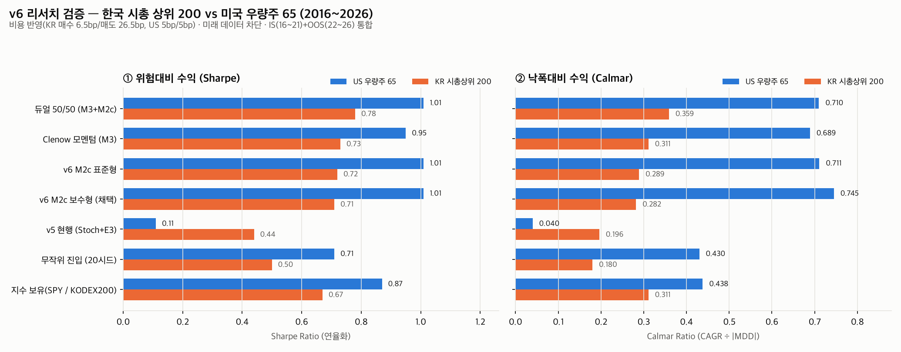
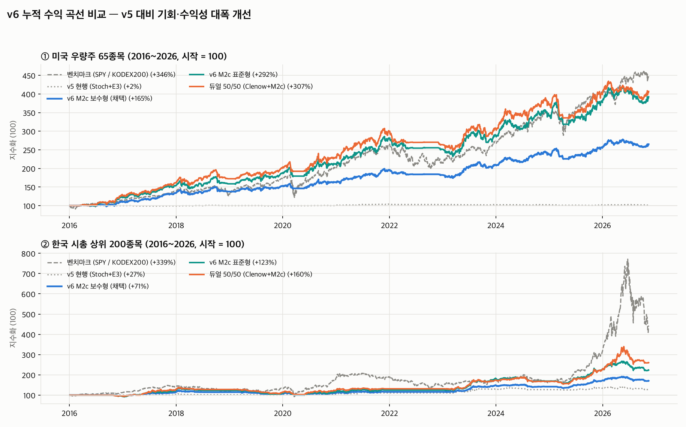

# v6 전략 리서치 보고서 — Reddit(`r/algotrading`) 방법론 통합 및 한국·미국 우량주 백테스트

> 한국 시총 상위 200종목(2016~2026) 및 미국 우량주 65종목(2016~2026, `SPY` 벤치마크)에 대해 v5 현행 전략을 진단하고, Reddit `r/algotrading`·실증 스윙/모멘텀 컨센서스를 방법론적으로 통합·백테스트해 **v6(`M2c_v6_보수형`)** 을 채택한 연구 기록입니다.

---

## 1. 문제 진단 — 왜 v5(`M0_v5_현행`)는 미국 우량주와 한국 대형주에서 자금이 놀았는가

v5(`Stoch(14,5,5)` + 주봉 `%K > %D` + 3분할 물타기 + `E3` + `RS60`)는 한국 시총 상위 200종목에서 10년 MDD `-11.4%`로 안정적이었으나, 두 가지 구조적 한계가 확인되었다.

1. **과도한 현금 대기(Cash Drag)**:
   - 한국 Top 200: 평균 투자비중 **`10.0%`**, 10년 CAGR **`2.23%`** (동일 기간 `KODEX 200` `14.61%`)
   - 미국 우량주 65종목: 평균 투자비중 **`4.4%`**, 10년 CAGR **`0.14%`** (OOS 2022~2026년 **CAGR `-0.39%` / PF `0.81` / Sharpe `-0.30`**)
2. **느린 이중 오실레이터 병목**:
   - `Stochastic(14, 5, 5)`의 이중 평활(`smooth=5`)과 직전 주봉 `%K > %D` 필터가 결합되면서, 미국 우량주처럼 우상향 추세가 꾸준한 시장에서는 `%K < 20` 과매도와 주봉 상승 조건이 동시에 거의 성립하지 않아 기회 대부분을 놓쳤다.

---

## 2. Reddit(`r/algotrading`) 스윙/모멘텀 방법론 핵심 컨센서스

커뮤니티 실증 논의에서 반복 검증된 스윙/모멘텀 아키텍처를 6가지 축으로 정리해 실험군(`M1`~`M5`)을 설계했다.

1. **레짐 필터 우선 (`Close > SMA200` + `SMA50 > SMA200` 정배열)**: 개별 종목이 장기 하락 추세에 있을 때의 역추세 물타기를 차단하고, 시장 벤치마크(`KODEX 200` / `SPY`) 200일선 필터로 시스템적 하락장을 회피.
2. **빠른 평균회귀 트리거 (`Connors RSI(2) < 10`, `IBS < 0.20 & Close < SMA5`)**: 느린 14일 이중 스토캐스틱 대신 `RSI(2)`·`IBS(Internal Bar Strength)` 등 단기 눌림목 지표를 사용해 우량주 상승 추세 안의 짧은 조정을 포착.
3. **모멘텀 품질 순위 (`Clenow90`)**: 단순 60일 수익률(`RS60`)은 급등락 잡주가 섞이기 쉬우므로, 90일 로그 가격 회귀 기울기(연율화) × 결정계수($R^2$)로 **매끄러운 우상향 추세**를 우선 배정.
4. **역변동성 포지션 사이징 (Inverse-Volatility Sizing)**: `배정금액 = 총자산 × target_risk / max(VOL20, 0.10)`(상한 `max_pos_weight`)로 변동성이 큰 종목은 작게, 안정적 우량주는 크게 실어 계좌 전체 MDD를 제어하고 다단계 물타기 자금 낭비를 제거.
5. **비대칭 청산 (`E3_atr`)**: 이익 중에는 20일 이동평균선(`MA20`) 안착 후 이탈까지 추세를 끝까지 타고, 손실 중에는 진입가 대비 `-2.5 * ATR(14)` 또는 `SMA200` 이탈 시 기계적으로 손절해 꼬리 위험을 제한.
6. **무작위 진입 대조군 (`Sanity_Random20`)**: 20개 시드 무작위 진입 평균과 동일 조건 전략을 직접 비교해 "체제·자금관리 덕분인지, 진입 신호에 실제 알파가 있는지"를 검증.

---

## 3. 백테스트 설계 (`backtest_research_v6.py`)

| 항목 | 한국 시장 (`KR_Top200`) | 미국 시장 (`US_BlueChip65`) |
|---|---|---|
| 유니버스 | 시총 상위 200종목 (실용 데이터 198개) | S&P 100 등 11개 섹터 대표 우량주 65종목 (`us_bluechips.csv`) |
| 벤치마크 | `069500` (KODEX 200) | `SPY` |
| 거래 비용 (왕복) | 매수 `0.065%` / 매도 `0.265%` | 매수 `0.050%` / 매도 `0.050%` |
| 검증 기간 | 전체 `2016~2026` · IS `2016~2021` · OOS `2022~2026` | 전체 `2016~2026` · IS `2016~2021` · OOS `2022~2026` |
| 포트폴리오 제약 | 최대 10종목, 다음 날 시가 체결, 미래 데이터(look-ahead) 차단 | 동일 |

---

## 4. 주요 전략 비교 결과

### A. 한국 시총 상위 200종목 (`KR_Top200`)

| 전략 | 전체 CAGR | 전체 MDD | 전체 Sharpe | 전체 Calmar | 투자비중 | 거래수 / 승률 / PF | IS(16~21) CAGR / PF | OOS(22~26) CAGR / MDD / Sharpe / Calmar / PF |
|---|---:|---:|---:|---:|---:|---|---:|---:|
| `Bench_Index_BH (069500)` | 14.61% | -46.9% | 0.67 | 0.311 | 100.0% | — | 11.20% / — | 18.94% / -46.9% / 0.70 / 0.404 |
| `Bench_Univ_EW` | 16.39% | -43.6% | 0.87 | 0.376 | 100.0% | — | 11.75% / — | 22.25% / -28.1% / 0.96 / 0.792 |
| `M0_v5_현행` | 2.23% | -11.4% | 0.44 | 0.196 | 10.0% | 648 / 38.1% / 1.42 | 1.71% / 1.47 | 2.89% / -11.4% / 0.45 / 0.254 / 1.39 |
| **`M2c_v6_보수형` (채택 · 0.016/0.10)** | **5.04%** | **-17.9%** | **0.71** | **0.282** | **21.9%** | **815 / 59.9% / 1.56** | **2.50% / 1.35** | **8.27% / -12.2% / 1.06 / 0.678 / 1.73** |
| `M2c_FastPullback_RSI2_IBS_E3` (0.025/0.15) | 7.69% | -26.6% | 0.72 | 0.289 | 34.0% | 815 / 59.9% / 1.56 | 3.74% / 1.35 | 12.77% / -18.5% / 1.06 / 0.690 / 1.73 |
| `M3_Clenow_Momentum` | 10.42% | -33.5% | 0.73 | 0.311 | 31.1% | 496 / 42.1% / 2.33 | 5.36% / 1.51 | 17.03% / -33.5% / 0.93 / 0.508 / 3.09 |
| `M4_Dual50_M2b` | 9.08% | -22.0% | 0.83 | 0.413 | 32.2% | 5036 / 52.0% / 1.79 | 5.88% / 1.34 | 13.19% / -22.0% / 1.02 / 0.599 / 2.20 |
| `M4_Dual50_M2c` | 9.21% | -25.7% | 0.78 | 0.359 | 32.5% | 1311 / 51.0% / 1.95 | 4.63% / 1.43 | 15.16% / -25.7% / 1.05 / 0.591 / 2.41 |
| `Sanity_Random20` (20시드 평균) | 4.77% | -27.68% | 0.50 | 0.180 | 38.66% | 1490.2 / 47.79% / 1.22 | 2.11% / 1.15 | 7.84% / -15.52% / 0.73 / 0.530 / 1.26 |

### B. 미국 우량주 65종목 (`US_BlueChip65`)

| 전략 | 전체 CAGR | 전체 MDD | 전체 Sharpe | 전체 Calmar | 투자비중 | 거래수 / 승률 / PF | IS(16~21) CAGR / PF | OOS(22~26) CAGR / MDD / Sharpe / Calmar / PF |
|---|---:|---:|---:|---:|---:|---|---:|---:|
| `Bench_Index_BH (SPY)` | 14.77% | -33.7% | 0.87 | 0.438 | 100.0% | — | 17.57% / — | 11.30% / -24.5% / 0.71 / 0.461 |
| `Bench_Univ_EW` | 18.56% | -33.1% | 1.07 | 0.560 | 100.0% | — | 23.47% / — | 12.67% / -22.4% / 0.85 / 0.564 |
| `M0_v5_현행` | 0.14% | -3.5% | 0.11 | 0.040 | 4.4% | 309 / 42.1% / 1.11 | 0.69% / 1.37 | -0.39% / -2.9% / -0.30 / -0.134 / 0.81 |
| `M2a_정배열_Stoch_역변동성` | 6.16% | -13.7% | 0.67 | 0.449 | 58.1% | 1235 / 44.7% / 1.29 | 8.30% / 1.43 | 4.50% / -10.0% / 0.52 / 0.449 / 1.13 |
| `M2b_FastPullback_RSI2_IBS_MR` | 7.11% | -17.9% | 0.67 | 0.397 | 63.1% | 5460 / 63.0% / 1.21 | 9.62% / 1.31 | 3.77% / -18.4% / 0.41 / 0.204 / 1.09 |
| **`M2c_v6_보수형` (채택 · 0.016/0.10)** | **9.39%** | **-12.6%** | **1.01** | **0.745** | **59.3%** | **1186 / 61.2% / 1.69** | **11.88% / 2.05** | **5.59% / -14.5% / 0.67 / 0.386 / 1.31** |
| `M2c_FastPullback_RSI2_IBS_E3` (0.025/0.15) | 13.42% | -18.9% | 1.01 | 0.711 | 79.7% | 1181 / 60.6% / 1.65 | 18.80% / 2.06 | 5.92% / -21.9% / 0.51 / 0.271 / 1.25 |
| `M3_Clenow_Momentum` | 14.00% | -20.3% | 0.95 | 0.689 | 78.5% | 460 / 50.9% / 2.44 | 21.25% / 3.62 | 6.17% / -18.6% / 0.50 / 0.332 / 1.42 |
| `M4_Dual50_M2c` | 13.79% | -19.4% | 1.01 | 0.710 | 79.1% | 1641 / 55.8% / 2.04 | 20.08% / 2.84 | 6.15% / -18.6% / 0.53 / 0.330 / 1.33 |
| `Sanity_Random20` (20시드 평균) | 7.01% | -16.89% | 0.71 | 0.430 | 65.07% | 1672.15 / 55.38% / 1.31 | 9.91% / 1.43 | 2.61% / -13.53% / 0.33 / 0.220 / 1.13 |

---

## 5. 왜 `M2c_v6_보수형` (`target_risk=0.016, max_pos_weight=0.10`)을 기본값으로 채택했는가

1. **무작위 대조군(`Sanity_Random20`) 대비 뚜렷한 알파 입증**:
   - **US**: `M2c_v6_보수형`은 CAGR `9.39%` vs Random `7.01%`, MDD `-12.6%` vs `-16.89%`, Sharpe `1.01` vs `0.71`, Calmar `0.745` vs `0.430`, PF `1.69` vs `1.31` (OOS CAGR도 `5.59%` vs `2.61%`, Sharpe `0.67` vs `0.33`).
   - **KR**: `M2c_v6_보수형`은 OOS Sharpe `1.06` vs Random `0.73`, Calmar `0.678` vs `0.530`, PF `1.73` vs `1.26`, MDD `-12.2%` vs `-15.52%`.
2. **운영 안전 한도(`MDD -15%` / `KILL_SWITCH`)와의 정합성**:
   - `M2c_FastPullback_RSI2_IBS_E3`(표준형 `0.025/0.15`)나 `M4_Dual50_M2c`는 CAGR이 `13.4~13.8%`(US) / `7.7~9.2%`(KR)로 높지만, 미국 전체 MDD `-18.9% ~ -19.4%`(OOS `-21.9% ~ -18.6%`)로 계좌 `max_drawdown_stop_pct = -15.0%` 한도를 상회해 실전 운영 중 잦은 매매 정지를 유발한다.
   - 반면 **`M2c_v6_보수형` (`0.016 / 0.10`)** 은 US 전체 MDD **`-12.6%`** (IS `-9.1%`, OOS **`-14.5%`**) 및 KR OOS MDD **`-12.2%`** 로 `-15%` 손실 한도 안에 안정적으로 들어오면서 **미국 전체 전략 중 Calmar 최고(`0.745`)**, **Sharpe `1.01`**, **PF `1.69`** 를 달성했다. (더 공격적인 수익을 원할 경우 `config.json`에서 `target_risk=0.025, max_pos_weight=0.15`만 변경해 표준형 `M2c`로 즉시 전환 가능)
3. **고회전 `M2b` 대비 거래 비용 내성과 보유 구조**:
   - `M2b`(SMA5 평균회귀 단타)는 KR 4,540건·US 5,460건의 초고빈도 매매(평균 3일 보유)로 거래 비용과 슬리피지에 취약하고 US OOS PF가 `1.09`로 약화된다.
   - `M2c`는 진입 후 이익 포지션을 `MA20` 이탈까지 보유(`E3_atr`, 평균 보유 ~19~21일)해 거래 빈도를 약 1/5로 줄이고 거래당 기대수익(KR `+2.96%`, US `+1.48%`)을 키웠다.

---

## 6. 주의 및 한계 (연구 윤리)

- **생존 편향(Survivorship Bias)**: 한국 유니버스(`universe200.csv`)와 미국 우량주(`us_bluechips.csv`) 모두 현 시점 살아남은 대형주·우량주 기준이므로 상장폐지·지배구조 훼손 종목 효과가 제외되어 절대 수익률이 과대 추정될 수 있다.
- **세금·슬리피지 가정**: 한국은 매수 `0.065%` / 매도 `0.265%`, 미국은 왕복 각 `0.05%` + 시가 체결을 가정했다. 미국 주식 실전 매매 시에는 해외주식 양도소득세, 환전 스프레드, 장전/장후 유동성 조건이 추가된다.
- **전체 상세 수치 CSV**: `results/v6_research_kr.csv`, `results/v6_research_us.csv` (`python backtest_research_v6.py` 실행 시 로컬 생성)
