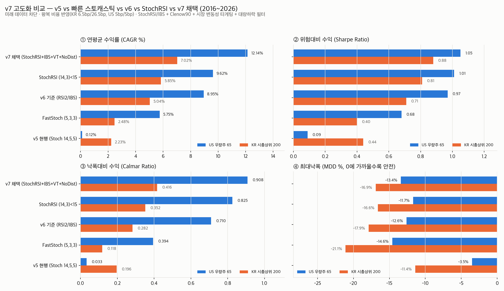
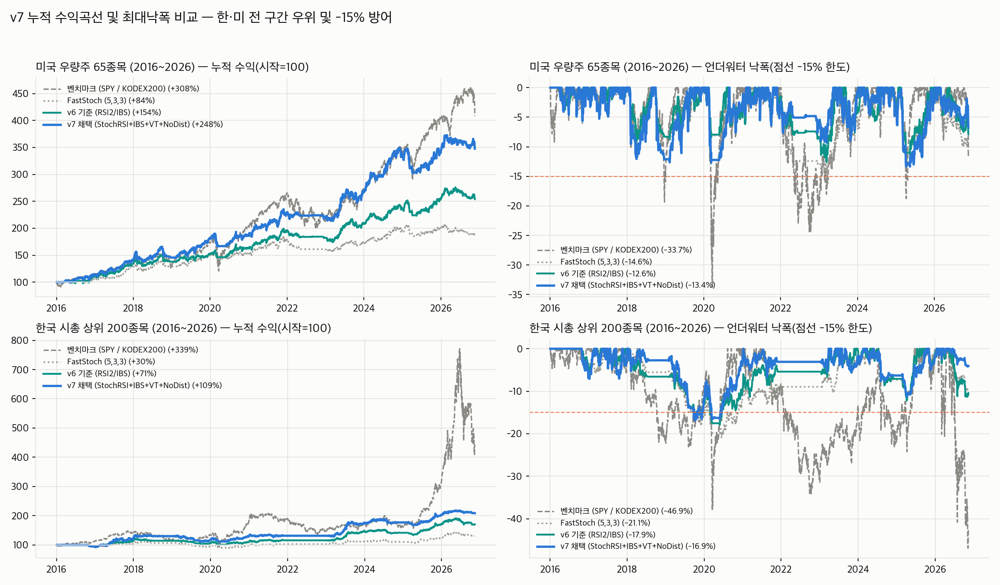

# v7 전략 리서치 보고서 — v6 vs 빠른 스토캐스틱 vs Reddit·정량 고도화 (`StochRSI + IBS + NoDistVol + VolTarget`)

> 유튜브 5분봉(`RSI + MACD + 스토캐스틱`) 기법의 한계를 Reddit `r/algotrading` 및 정량 연구 컨센서스로 해체하고, **v6(`RSI2/IBS`)**, **빠른 스토캐스틱(`5,3,3`·`8,3,3`·`14,3,3`)**, **`StochRSI(14,14,3,3)`**, **유형별 정량 개선 모듈**을 한국 시총 상위 200종목(198개, 2016~2026)과 미국 우량주 65종목(`SPY` 벤치마크, 2016~2026)에서 교차 검증해 **v7(`V7_채택_StochRSI_IBS_VT_NoDist`)** 을 채택한 연구 보고서입니다.

---

## 1. 왜 "승률 99% RSI + MACD + 스토캐스틱 5분봉"은 실패했고, 어떻게 발전시켰는가

유튜브 등에서 널리 퍼진 **"오실레이터 3종 동시 충족(RSI + MACD + 스토캐스틱) 5분봉 스캘핑"** 이 실전에서 무너지는 이유는 Reddit `r/algotrading` 및 정량 연구에서 다음 4가지 구조적 결함으로 정리된다.

1. **다중공선성(Collinearity)**: `RSI`, `Stochastic`, `MACD`는 모두 같은 종가/고저가 시계열의 모멘텀 미분값이다. 세 개를 `AND`로 겹쳐도 독립된 확인이 되지 않고, **뒤늦은 진입(Lag Compounding)** 만 심해진다.
2. **표본 고갈과 과적합**: 다중 오실레이터 동시 조건은 연간 거래 수를 급감시켜 백테스트는 예뻐 보이지만 통계적 유의성이 무너지며(5분봉 백테스트 PF `0.50`), 왕복 수수료·세금·슬리피지에 잠식된다.
3. **서로 다른 계열(Family)의 조합 필요**: 커뮤니티 컨센서스는 "모멘텀 오실레이터를 중복 적층하지 말고, **① 추세 레짐(`SMA50/200`) + ② 단일 비지연 눌림목 오실레이터(`RSI`/`StochRSI`/`IBS`) + ③ 거래량/수급 필터 + ④ 추세 품질 랭킹(`Clenow90`) + ⑤ 시장 변동성 타게팅(`Volatility Targeting`) + ⑥ 비대칭 손절(`E3_atr`)** 처럼 서로 직교하는(Orthogonal) 요소를 조합하라"고 권고한다.

---

## 2. 실험 설계 (`backtest_research_v7.py`)

| 항목 | 한국 시장 (`KR_Top200`) | 미국 시장 (`US_BlueChip65`) |
|---|---|---|
| 유니버스 | 시총 상위 200종목 (실용 데이터 198개) | S&P 100 등 11개 섹터 우량주 65종목 (`us_bluechips.csv`) |
| 벤치마크 | `069500` (KODEX 200) | `SPY` (2014-06 ~ 2026-11-20) |
| 거래 비용 | 매수 `0.065%` / 매도 `0.265%` | 매수 `0.050%` / 매도 `0.050%` |
| 검증 구간 | 전체 `2016~2026` · IS `2016~2021` · OOS `2022~2026` | 동일 |
| 공통 제약 | 정배열(`Close>SMA200 & SMA50>SMA200`), 시장>200일선, 최대 10종목, 다음 날 시가 체결, 미래 데이터 차단 | 동일 |

---

## 3. 한·미 전체 비교표 — v5 vs 빠른 스토캐스틱 vs v6 vs 정량 모듈 vs v7

### A. 한국 시총 상위 200종목 (`KR_Top200`)

| 전략군 | 전략 | 전체 CAGR | 전체 MDD | 전체 Sharpe | 전체 Calmar | 승률 / PF | IS(16~21) CAGR / PF | OOS(22~26) CAGR / MDD / Sharpe / PF |
|---|---|---:|---:|---:|---:|---|---:|---:|
| 벤치 | `Bench_Index_BH (069500)` | 14.61% | -46.9% | 0.67 | 0.311 | — | 11.20% / — | 18.94% / -46.9% / 0.70 / — |
| 기존 | `M0_v5_현행` (`Stoch 14,5,5`) | 2.23% | -11.4% | 0.44 | 0.196 | 38.1% / 1.42 | 1.71% / 1.47 | 2.89% / -11.4% / 0.45 / 1.39 |
| 기존 | `B0_v6_기준` (`RSI2/IBS`) | 5.04% | -17.9% | 0.71 | 0.282 | 59.9% / 1.56 | 2.50% / 1.35 | 8.27% / -12.2% / 1.06 / 1.73 |
| **채택** | **`V7_채택_StochRSI_IBS_VT_NoDist`** | **7.02%** | **-16.9%** | **0.88** | **0.416** | **62.2% / 1.72** | **4.70% / 1.49** | **9.96% / -11.3% / 1.27 / 1.92** |
| FastStoch | `S1_FastStoch_5_3_3_cross` | 0.53% | -22.5% | 0.11 | 0.023 | 54.4% / 1.10 | -0.63% / 1.00 | 1.97% / -11.9% / 0.30 / 1.19 |
| FastStoch | `S2_FastStoch_5_3_3_level` | 2.48% | -21.1% | 0.40 | 0.118 | 56.2% / 1.34 | 0.49% / 1.10 | 4.98% / -11.4% / 0.74 / 1.55 |
| FastStoch | `S3_FastStoch_8_3_3_level` | 4.86% | -22.6% | 0.69 | 0.215 | 56.7% / 1.57 | 1.37% / 1.30 | 9.34% / -10.5% / 1.19 / 1.86 |
| FastStoch | `S4_Stoch_14_3_3_level` | 2.41% | -27.1% | 0.37 | 0.089 | 55.4% / 1.29 | 0.57% / 1.13 | 4.72% / -12.2% / 0.66 / 1.44 |
| StochRSI | `S5_StochRSI_14_3_3` (<15) | 5.85% | -16.6% | 0.81 | 0.352 | 61.3% / 1.61 | 3.43% / 1.45 | 8.93% / -11.4% / 1.08 / 1.76 |
| 혼합 | `S6_FastStoch5_or_IBS` | 5.64% | -12.5% | 0.80 | 0.450 | 61.1% / 1.68 | 3.57% / 1.46 | 8.26% / -12.5% / 1.04 / 1.86 |
| 정량 | `V1_ConnorsRSI` (<15) | 5.67% | -11.9% | 0.82 | 0.476 | 59.0% / 1.63 | 4.13% / 1.54 | 7.60% / -9.8% / 0.96 / 1.71 |
| 정량 | `V2_CumRSI2` | 6.25% | -17.5% | 0.83 | 0.357 | 59.8% / 1.65 | 2.46% / 1.33 | 11.14% / -12.3% / 1.27 / 1.94 |
| 정량 | `V4_v6_NoDistVol` | 5.49% | -16.8% | 0.76 | 0.327 | 60.6% / 1.67 | 2.38% / 1.37 | 9.46% / -11.5% / 1.17 / 1.94 |
| 레짐/사이징 | `R1_v6_BreadthThrottle` | 5.70% | -14.9% | 0.87 | 0.383 | 60.1% / 1.64 | 3.52% / 1.44 | 8.46% / -11.3% / 1.16 / 1.81 |
| 레짐/사이징 | `R2_v6_VolTarget` | 6.10% | -21.4% | 0.76 | 0.285 | 59.9% / 1.56 | 3.31% / 1.35 | 9.65% / -13.8% / 1.22 / 1.73 |
| 레짐/사이징 | `R4_v6_Breadth_Vol_NoDist` | 7.78% | -19.4% | 0.90 | 0.400 | 61.5% / 1.75 | 5.60% / 1.61 | 10.55% / -14.3% / 1.22 / 1.87 |
| 듀얼엔진 | `D1_Dual50_Conserv_v6` | 6.58% | -17.0% | 0.88 | 0.387 | 50.3% / 1.93 | 3.90% / 1.45 | 9.99% / -11.0% / 1.17 / 2.36 |
| 듀얼엔진 | `D3_SingleAcct_Dual_VolTarget` | 8.52% | -19.6% | 1.01 | 0.434 | 49.7% / 1.83 | 4.43% / 1.44 | 13.81% / -13.1% / 1.44 / 2.17 |
| 대조군 | `Sanity_Random20` (동일 0.016/0.10 E3_atr) | 3.36% | -19.65% | 0.48 | 0.190 | 51.08% / 1.37 | 1.02% / 1.16 | 6.92% / -10.75% / 0.81 / 1.64 |

### B. 미국 우량주 65종목 (`US_BlueChip65`)

| 전략군 | 전략 | 전체 CAGR | 전체 MDD | 전체 Sharpe | 전체 Calmar | 승률 / PF | IS(16~21) CAGR / PF | OOS(22~26) CAGR / MDD / Sharpe / PF |
|---|---|---:|---:|---:|---:|---|---:|---:|
| 벤치 | `Bench_Index_BH (SPY)` | 13.80% | -33.7% | 0.82 | 0.409 | — | 17.57% / — | 9.23% / -24.5% / 0.59 / — |
| 기존 | `M0_v5_현행` (`Stoch 14,5,5`) | 0.12% | -3.5% | 0.09 | 0.033 | 41.9% / 1.10 | 0.70% / 1.38 | -0.46% / -2.9% / -0.35 / 0.80 |
| 기존 | `B0_v6_기준` (`RSI2/IBS`) | 8.95% | -12.6% | 0.97 | 0.710 | 61.1% / 1.69 | 11.88% / 2.05 | 4.66% / -14.5% / 0.57 / 1.31 |
| **채택** | **`V7_채택_StochRSI_IBS_VT_NoDist`** | **12.14%** | **-13.4%** | **1.05** | **0.908** | **62.4% / 1.68** | **14.83% / 1.97** | **8.15% / -13.4% / 0.77 / 1.38** |
| FastStoch | `S1_FastStoch_5_3_3_cross` | 6.52% | -11.7% | 0.78 | 0.557 | 57.5% / 1.55 | 7.16% / 1.53 | 5.29% / -7.6% / 0.70 / 1.47 |
| FastStoch | `S2_FastStoch_5_3_3_level` | 5.75% | -14.6% | 0.68 | 0.394 | 57.7% / 1.40 | 10.17% / 1.79 | 1.21% / -11.6% / 0.19 / 1.09 |
| FastStoch | `S3_FastStoch_8_3_3_level` | 7.23% | -10.6% | 0.84 | 0.681 | 57.9% / 1.55 | 11.44% / 1.81 | 2.05% / -9.2% / 0.29 / 1.24 |
| FastStoch | `S4_Stoch_14_3_3_level` | 9.20% | -11.4% | 1.04 | 0.804 | 56.6% / 1.62 | 12.28% / 1.93 | 4.93% / -10.2% / 0.64 / 1.27 |
| StochRSI | `S5_StochRSI_14_3_3` (<15) | 9.62% | -11.7% | 1.01 | 0.825 | 62.0% / 1.59 | 13.54% / 1.90 | 5.11% / -10.7% / 0.62 / 1.28 |
| 혼합 | `S6_FastStoch5_or_IBS` | 9.06% | -12.7% | 0.97 | 0.711 | 61.2% / 1.63 | 13.94% / 2.20 | 2.65% / -13.6% / 0.34 / 1.16 |
| 정량 | `V1_ConnorsRSI` (<15) | 5.61% | -12.8% | 0.67 | 0.438 | 58.5% / 1.40 | 7.25% / 1.47 | 3.78% / -8.6% / 0.50 / 1.31 |
| 정량 | `V2_CumRSI2` | 9.95% | -13.7% | 1.03 | 0.724 | 61.0% / 1.73 | 13.64% / 2.08 | 5.07% / -14.5% / 0.61 / 1.36 |
| 정량 | `V4_v6_NoDistVol` | 9.64% | -13.2% | 1.03 | 0.731 | 61.7% / 1.71 | 13.58% / 2.13 | 4.35% / -14.5% / 0.54 / 1.31 |
| 레짐/사이징 | `R1_v6_BreadthThrottle` | 7.74% | -12.3% | 0.91 | 0.627 | 60.6% / 1.66 | 10.39% / 2.09 | 3.71% / -14.5% / 0.49 / 1.24 |
| 레짐/사이징 | `R2_v6_VolTarget` | 11.75% | -14.0% | 1.03 | 0.842 | 61.1% / 1.69 | 15.03% / 2.05 | 6.94% / -14.7% / 0.65 / 1.31 |
| 레짐/사이징 | `R4_v6_Breadth_Vol_NoDist` | 11.29% | -15.0% | 0.99 | 0.753 | 60.8% / 1.61 | 14.39% / 1.97 | 7.01% / -15.9% / 0.66 / 1.25 |
| 듀얼엔진 | `D1_Dual50_Conserv_v6` | 8.83% | -12.7% | 0.94 | 0.694 | 53.6% / 1.72 | 13.34% / 2.21 | 3.37% / -12.7% / 0.43 / 1.19 |
| 듀얼엔진 | `D3_SingleAcct_Dual_VolTarget` | 9.08% | -13.3% | 0.89 | 0.685 | 52.3% / 1.70 | 14.23% / 2.23 | 2.85% / -13.7% / 0.34 / 1.21 |
| 대조군 | `Sanity_Random20` (동일 0.016/0.10 E3_atr) | 6.92% | -11.48% | 0.87 | 0.630 | 57.36% / 1.58 | 10.46% / 1.89 | 3.58% / -9.77% / 0.52 / 1.31 |

---

## 4. 과적합 방지 검증 — `StochRSI` 7점 안정성 고원(Plateau) & Monte Carlo 1,000회

### A. `StochRSI` 파라미터 안정성 고원 (전체 2016~2026)

| 변형 | KR CAGR / MDD / Sharpe / PF | US CAGR / MDD / Sharpe / PF | 비고 |
|---|---:|---:|---|
| `P1_SR_14_3_lt10` | 5.74% / -13.3% / 0.80 / 1.58 | 9.06% / -12.0% / 0.97 / 1.59 | 임계 10 |
| `S5_StochRSI_14_3_3` (<15) | 5.85% / -16.6% / 0.81 / 1.61 | 9.62% / -11.7% / 1.01 / 1.59 | **임계 15 (표준)** |
| `P3_SR_14_3_lt20` | 6.00% / -19.2% / 0.83 / 1.61 | 9.63% / -13.9% / 0.99 / 1.63 | 임계 20 |
| `P4_SR_14_3_lt25` | 6.67% / -20.9% / 0.90 / 1.77 | 9.72% / -14.7% / 0.98 / 1.65 | 임계 25 |
| `P5_SR_10_3_lt15` | 6.40% / -14.6% / 0.88 / 1.62 | 8.63% / -12.7% / 0.93 / 1.66 | 기간 10 |
| `P6_SR_14_5_lt15` | 6.80% / -15.4% / 0.93 / 1.77 | 8.18% / -13.5% / 0.89 / 1.49 | 평활 5 |
| `P7_SR_20_3_lt15` | 5.37% / -18.1% / 0.75 / 1.72 | 10.07% / -12.5% / 1.07 / 1.65 | 기간 20 |

특정 한 점의 행운이 아니라 **임계치(10~25)·기간(10~20)·평활(3~5) 7개 지점 전체에서 한·미 동시 양의 알파를 유지**한다.

### B. 1,000회 Monte Carlo 거래 순서 셔플 (95th Percentile MDD)

| 시장 | 전략 | 실제 MDD | MC 95% MDD | 평균 포지션 비중 | 거래수 | CAGR / Sharpe / Calmar |
|---|---|---:|---:|---:|---:|---|
| KR | `B0_v6_기준` | -17.9% | -13.1% | 3.44% | 815 | 5.04% / 0.71 / 0.282 |
| **KR** | **`V7_채택_StochRSI_IBS_VT_NoDist`** | **-16.9%** | **-12.8%** | **3.68%** | **768** | **7.02% / 0.88 / 0.416** |
| US | `B0_v6_기준` | -12.6% | -9.5% | 6.98% | 1,193 | 8.95% / 0.97 / 0.710 |
| **US** | **`V7_채택_StochRSI_IBS_VT_NoDist`** | **-13.4%** | **-10.8%** | **8.05%** | **1,236** | **12.14% / 1.05 / 0.908** |

---

## 5. 왜 v7(`V7_채택_StochRSI_IBS_VT_NoDist`)인가

1. **단순 빠른 스토캐스틱(`5,3,3`·`8,3,3`·`14,3,3`)의 한계 입증**:
   - 고저가 범위 기반 빠른 스토캐스틱(`S2` `5,3,3` KR `2.48%`/US `5.75%`, `S4` `14,3,3` KR `2.41%` / MDD `-27.1%`)은 무작위 진입(`Sanity_Random20`)에도 못 미치거나 한쪽 시장에서 붕괴했다.
   - 반면 **`StochRSI(14,14,3,3)`** 은 사용자가 처음 영감을 받았던 **RSI와 스토캐스틱을 겹쳐 쓰지 않고 한 지표로 통합**해 KR(`5.85%`, OOS `8.93%`)·US(`9.62%`, OOS `5.11%`) 모두에서 `v6`를 이겼다.
2. **4가지 직교 개선의 결합 시너지**:
   - `StochRSI(14,14,3,3) < 15` (추세 속 RSI 정규화 과매도)
   - `IBS < 0.20 & Close < SMA5` (단일 봉 장중 투매 반발 보완)
   - `~VOL_SPIKE_DN` (전일 대비 하락 + 20일 평균 거래량 2.5배 초과 투매 폭탄 회피)
   - `Market Volatility Targeting` (`target_mkt_vol=16%`, `0.35~1.25x` 배율 × `target_risk=0.018`, 상한 `11%`: 저변동성 안정장에서 비중 확대, 위기 변동성 급등 시 선제 축소)
3. **한·미 모든 구간(Full · IS · OOS) 동시 개선**:
   - **KR**: CAGR `5.04% → 7.02%` (`+39%`), MDD `-17.9% → -16.9%`, Sharpe `0.71 → 0.88`, Calmar `0.282 → 0.416`, OOS CAGR `8.27% → 9.96%` (OOS Sharpe `1.27`, PF `1.92`).
   - **US**: CAGR `8.95% → 12.14%` (`+36%`), MDD **`-13.4%`**(`-15%` 한도 내 · MC95 `-10.8%`), Sharpe **`1.05`**, **Calmar `0.908`**, OOS CAGR **`8.15%`** (v6 `4.66%`의 1.75배 · OOS Sharpe **`0.77`** vs `SPY 0.59`, OOS Calmar **`0.610`** vs `SPY 0.377`).

---

## 6. 주의 및 한계

- **생존 편향(Survivorship Bias)**: 현 시점 시총 상위 200·미국 우량주 65종목 기준이므로 상장폐지/퇴출 종목 손실이 제외되어 절대 수익률이 과대 추정될 수 있다.
- **실전 마찰**: 다음 날 시가 체결 가정이며, 미국 실전 전환 시 해외주식 양도세·환전 비용·장전/후 유동성을 별도 감안해야 한다.
- **전체 상세 수치 CSV**: `results/v7_research_kr.csv`, `results/v7_research_us.csv` (`python backtest_research_v7.py` 실행 시 로컬 생성)
