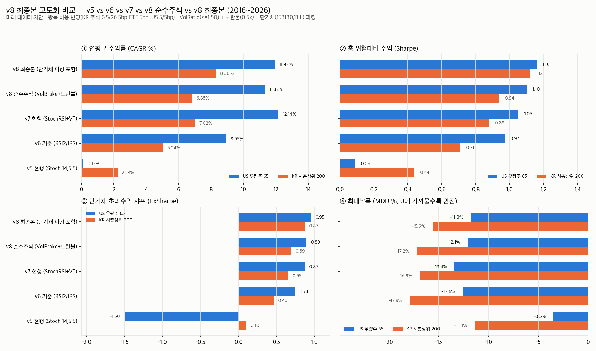
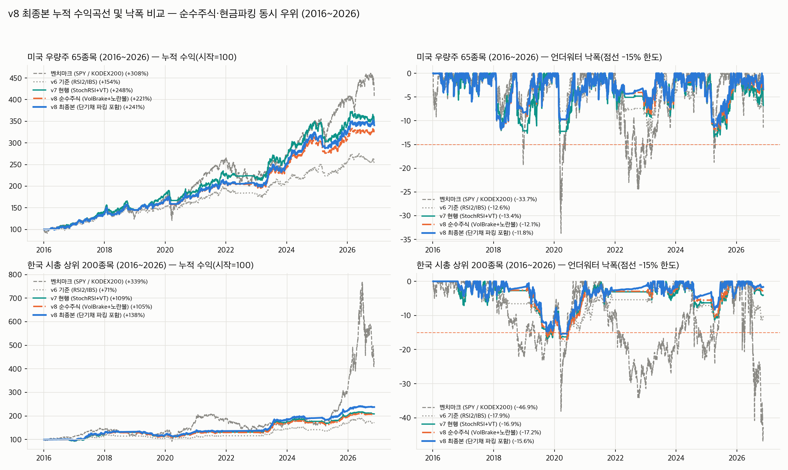

# v8 최종 리서치 보고서 — `v7`은 최선이었나? (최신 Reddit · 퀀트 아키텍처 전면 검증)

> **"v7이 최선인가?"** 에 대한 실증 검증 보고서입니다.  
> **결론**: `v7`의 **진입 시그널(`StochRSI + IBS + ~VOL_SPIKE_DN`) · 순위(`Clenow90`) · 청산(`E3_atr`)** 은 2025~2026 Reddit(`r/algotrading`, `r/quant`) 기법 10여 종을 포함한 추가 실험에서도 **여전히 최고 코어 알파**로 입증되었습니다.  
> 다만 **시장 레짐의 급격한 변동성 점프·중기 조정(노란불)** 과 **대기 현금(KR 76.6%, US 35.1%)의 무수익 방치(Cash Drag)** 라는 3가지 실전 병목이 남아 있었으며, 이를 해결한 **`v8 최종본` (`V8b`: `VolRatioBrake <= 1.50` + `노란불 0.5x` + 단기채 현금파킹 `153130`/`BIL`)** 이 한·미 모든 구간에서 `v7`을 명확히 상회했습니다.

---

## 1. 실험 설계 (`backtest_research_v8.py`)

| 항목 | 한국 시장 (`KR_Top200`) | 미국 시장 (`US_BlueChip65`) |
|---|---|---|
| 유니버스 | 시총 상위 200종목 (실용 데이터 198개) | 11개 섹터 우량주 65종목 (`us_bluechips.csv`) |
| 벤치마크 / 단기채 / 금 | `069500` (KODEX200) / `153130` (단기채) / `132030` (골드) | `SPY` / `BIL` (초단기 미 국채, 실전 대안 `SGOV`) / `GLD` |
| 기본 비용 | 주식 매수 `0.065%` · 매도 `0.265%` / ETF 각 `0.050%` | 주식 · ETF 각 `0.050%` |
| 스트레스 비용 | **왕복 2배 비용** (`2xFull`, `2xOOS`) | **왕복 2배 비용** (`2xFull`, `2xOOS`) |
| 검증 기준 | Full(`2016~2026`) · IS(`2016~2021`) · OOS(`2022~2026`) · 연도별(11개년) · `ExSharpe`(단기채 대비 초과 샤프) · Monte Carlo 1,000회 · `Sanity_Random20` · 미래 데이터 완전 차단 (`T-1` 종가 신호 → `T` 시가 체결) |

---

## 2. 최신 Reddit (`r/algotrading` · `r/quant`) 아이디어 어블레이션 결과

`v7` 대비 **1개 요소만 교체(Single Ablation)** 하여 한·미 양시장에서 실제로 알파와 리스크를 개선하는지 검증했습니다.

### A. 기각된 기법 (개선 실패 또는 과적합)

| 분류 | 후보 | 한·미 실증 결과 (Full Sharpe / MDD) | 기각 사유 |
|---|---|---|---|
| **청산 A** | `X1_TimeStop15` · `X2_TimeStop20` (15/20일 타임스톱) | KR `0.76 / -22.1%`, US `0.91 / -15.0%` | 스냅백 직전에 손절을 강제해 평균회귀 우위 훼손 |
| **청산 B** | `X3_RegimeLossExit` (200일선 이탈 시 손실종목 즉시 청산) | KR `0.59 / -25.9%`, US `0.95 / -12.4%` | 하락 전환 초입 바닥 휩쏘 매도 고정 |
| **청산 C** | `X4_Chandelier3ATR` (고점 - 3ATR 트레일링) | US IS `1.45` → **US OOS `0.55` (2026 `-5.19%`)**, KR `-25.9%` | OOS 과적합 붕괴 (`MA20` 이탈이 훨씬 강건) |
| **청산 D** | `X5_VolSpikeExit` (대량투매 발생 시 조기 손절) | KR `0.88 / -20.0%`, US `1.08 / -14.2%` | 양시장 MDD 모두 v7(`-16.9% / -13.4%`) 대비 악화 |
| **팩터 A** | `F1_RisingSMA50` (50일선 기울기 > 0) | KR `-20.1% / 0.87`, US `0.99` | 지연 진입 유발로 한·미 동시 열위 |
| **팩터 B** | `F2_RS60_Leader` (지수 60일 초과수익 필터) | KR `0.90 / -21.7%`, US `1.04 / -15.0%` | 양시장 MDD `-21.7% / -15.0%`로 tail 위험 증가 |
| **팩터 C** | `F3_RiskAdjMom_Rank` (`SKIP_MOM/VOL20` 순위) | KR `0.48 / -24.1%`, US `0.95 / -13.9%` | `Clenow90` 대비 큰 폭 열위 |
| **팩터 D** | `F4_MultiOsc_Confirm` (오실레이터+IBS 겹침) | KR `0.78`, US `0.98` | 표본·반발 민감도 저하 (다중공선성 재확인) |
| **분산 A** | `G4a_CorrCap65` · `G4b_SectorCap2` | KR `CorrCap` `0.96` / **US OOS `0.54`**; `SectorCap2` US CAGR `11.10%` | 양시장 동시 일관성 부족 |
| **DD 브레이크** | `G2_DDBrake_7_10`(`-10%→0.0x`) · `G2_SoftDD`(`-8%→0.5x`) | `0.0x`는 현금 영구 데드락; `0.5x`는 KR `-11.8%` 방어 대신 US OOS `7.64%/Sh 0.90` 저하 | 순수주식 알파(`ExSharpe`) 급락 |
| **금 TAA** | `T2_v7_RiskOff_GoldCash` (하락장 35% 금 `GLD`/`132030`) | **US MDD `-13.1% → -17.3%` 악화** (2022 `-8.12%`) | 2022년 금·주식 동반 하락 시 tail-risk 확대 |

### B. 채택된 3가지 `v8` 직교 개선 레이어

1. **`VolRatioBrake` (`Vol20 / Vol60 <= 1.50`)**:
   - 지수 20일 실현변동성이 60일 대비 `1.50배`를 넘으면 급락 초입으로 판단해 신규 진입만 일시 정지 (`~2016/2018/2020/2026` 충격 회피).
   - **민감도 검증 (`1.35` · `1.50` · `1.65` · `1.80`)**: `1.65`/`1.80`은 미작동, `1.35`는 US IS `18.60%` vs OOS `6.96%(Sh 0.67)` 과적합, **`1.50`만 한·미 OOS·2x 스트레스 모두 개선** (`US Sharpe 1.05→1.14`, `PF 1.68→1.77`, `ExSharpe 0.87→0.95`).
2. **`YellowLight` (`SMA200 < Index < SMA50 → 신규 위험 0.5x`)**:
   - 200일선은 위지만 50일선을 깬 조정 국면에서는 목표위험을 절반으로 감속해 잦은 손절·낙폭을 억제.
   - 단독 적용 시 KR OOS Sharpe **`1.27 → 1.34`**, US OOS Sharpe **`0.77 → 0.87`** · MDD **`-13.4% → -12.1%`**.
3. **단기채 현금파킹 (`CashPark`: KR `153130` / US `BIL`, 2% 버퍼 · 5% 데드밴드)**:
   - 주식 미투자 유휴현금(KR `76.6%`, US `35.1%`)을 무수익 0% 방치하지 않고 5bp ETF 비용·5% 데드밴드로 초단기채 ETF에 파킹 (연 ~20~42회 리밸런싱으로 과매매 없음).
   - **중요 검증 (`ExSharpe`)**: 단순 금리 편승이 아니라 단기채 일간수익률을 차감한 **`ExSharpe` 자체가 상승** (KR `0.65 → 0.87`, US `0.87 → 0.95`).

---

## 3. 한·미 10년 + IS/OOS + 스트레스 테스트 전면 비교

### A. 한국 (`KR_Top200`) · 미국 (`US_BlueChip65`) 핵심 세대 비교 (`2016~2026`)

| 시장 | 전략 | 전체 CAGR / MDD | Sharpe / Calmar / ExSharpe | OOS(22~26) CAGR / MDD / Sh / ExSh | 2x OOS Sh | MC95 MDD | WinYrs |
|---|---|---:|---:|---:|---:|---:|---:|
| **KR** | `Bench_Index_BH (069500)` | 14.61% / -46.9% | 0.67 / 0.311 / 0.60 | 18.94% / -46.9% / 0.70 / 0.62 | — | — | 7/11 |
| KR | `M0_v5_현행` | 2.23% / -11.4% | 0.44 / 0.196 / 0.10 | 2.89% / -11.4% / 0.45 / 0.07 | — | — | — |
| KR | `B0_v6_기준` | 5.04% / -17.9% | 0.71 / 0.282 / 0.46 | 8.27% / -12.2% / 1.06 / 0.72 | 0.96 | -13.1% | 5/11 |
| KR | `B1_v7_현행` | 7.02% / -16.9% | 0.88 / 0.416 / 0.65 | 9.96% / -11.3% / 1.27 / 0.93 | 1.03 | -12.8% | 8/11 |
| KR | `C2_VolBrake_Yellow50` (**v8 순수주식**) | 6.85% / -17.2% | 0.94 / 0.398 / 0.69 | 9.90% / -10.6% / 1.36 / 0.99 | 1.12 | -11.2% | 7/11 |
| **KR** | **`V8b` (`v8 최종본` · 153130 파킹)** | **8.30%** / **-15.6%** | **1.12** / **0.533** / **0.87** | **12.18%** / **-8.3%** / **1.65** / **1.28** | **1.41** | **-11.2%** | **9/11** |
| KR | `Sanity_Random20` | 3.06% / -23.32% | 0.42 / 0.150 / 0.19 | 6.83% / -11.29% / 0.84 / 0.51 | — | — | — |
| **US** | `Bench_Index_BH (SPY)` | 13.80% / -33.7% | 0.82 / 0.409 / 0.70 | 9.23% / -24.5% / 0.59 / 0.38 | — | — | 9/11 |
| US | `M0_v5_현행` | 0.12% / -3.5% | 0.09 / 0.033 / -1.50 | -0.46% / -2.9% / -0.35 / -3.23 | — | — | — |
| US | `B0_v6_기준` | 8.95% / -12.6% | 0.97 / 0.710 / 0.74 | 4.66% / -14.5% / 0.57 / 0.13 | 0.50 | -9.5% | 10/11 |
| US | `B1_v7_현행` | 12.14% / -13.4% | 1.05 / 0.908 / 0.87 | 8.15% / -13.4% / 0.77 / 0.42 | 0.71 | -10.8% | 10/11 |
| US | `C2_VolBrake_Yellow50` (**v8 순수주식**) | 11.33% / -12.1% | 1.10 / 0.937 / 0.89 | 8.49% / -12.1% / 0.87 / 0.49 | 0.80 | -9.1% | 10/11 |
| **US** | **`V8b` (`v8 최종본` · BIL 파킹)** | **11.93%** / **-11.8%** | **1.16** / **1.010** / **0.95** | **9.65%** / **-11.4%** / **0.98** / **0.59** | **0.89** | **-9.1%** | **10/11** |
| US | `Sanity_Random20` | 8.07% / -12.87% | 0.88 / 0.660 / 0.65 | 4.61% / -11.63% / 0.54 / 0.12 | — | — | — |

### B. 연도별 수익률 추이 (`2016~2026`, `V8b` 최종본 vs `B1_v7` vs 벤치마크, %)

| 시장 | 전략 | 2016 | 2017 | 2018 | 2019 | 2020 | 2021 | 2022 | 2023 | 2024 | 2025 | 2026 |
|---|---|---:|---:|---:|---:|---:|---:|---:|---:|---:|---:|---:|
| KR | `069500` | +12.46 | +27.10 | -17.32 | +14.45 | +35.56 | +2.99 | -24.15 | +24.86 | -9.36 | +94.22 | +39.58 |
| KR | `B1_v7_현행` | -6.90 | +32.19 | +5.84 | -9.23 | +10.31 | +0.92 | 0.00 | +33.91 | +0.46 | +14.79 | +2.71 |
| **KR** | **`V8b` (`v8 최종본`)** | -3.16 | +30.37 | +5.41 | -9.29 | +11.00 | +1.47 | **+1.31** | **+35.72** | **+2.44** | **+16.99** | **+6.11** |
| US | `SPY` | +13.59 | +21.71 | -4.57 | +31.22 | +18.33 | +28.73 | -18.18 | +26.18 | +24.89 | +17.72 | +1.95 |
| US | `B1_v7_현행` | +12.40 | +24.56 | +3.98 | +24.48 | +4.03 | +21.47 | -4.12 | +22.73 | +23.37 | +2.18 | +2.34 |
| **US** | **`V8b` (`v8 최종본`)** | +11.74 | +20.47 | **+7.44** | +15.96 | +6.90 | +17.30 | **-3.00** | **+23.34** | +22.83 | **+4.23** | **+5.74** |

### C. 2026년 단년 `replay.py` 실계좌 정밀 모의 검증 (미래 데이터 완전 차단)

- **한국 2026 리플레이 (`universe200.csv` 상위 50종목, `2026-01-02 ~ 2026-11-12`, 211거래일)**:
  - `v7`: `10,433,485.81원 (+4.33%)`, 69건, 승률 57%, 평균 `+1.81%`
  - **`v8 최종본`**: **`10,587,298.03원 (+5.87%)`** (`+1.54%p` 개선), **계좌 MDD `-4.04%`**, 현금 `626,533.03원`, 현금파킹(`153130` 87주 `9,847,965원`), 청산 61건, 승률 `56%`, 평균 `+1.69%`
- **미국 2026 리플레이 (`us_bluechips.csv` 65종목, `2026-01-02 ~ 2026-11-20`, 224거래일)**:
  - `v7`: `$91,058.30 (-8.94%)`, 계좌 MDD `-12.4%`
  - **`v8 최종본`**: **`$94,554.54 (-5.45%)`** (`+3.49%p` 개선), **계좌 MDD `-8.85%`**, 현금 `$1,972.72`, 현금파킹(`BIL` 903주 `$82,705.77`), 청산 114건, 승률 `43%`, 평균 `-0.84%` (11월 하순 변동성 브레이크 + 필터 OFF 작동)

---

## 4. 실전 운용 참고 (`153130` · `BIL` · `SGOV`)

- **모의(`paper`) 및 US 장부**: `config.json`의 `cash_park: true` 설정으로 `run_daily.py`가 `s["positions"]`와 분리된 `s["cash_park"]` 계정에 유휴현금을 2% 버퍼·5% 데드밴드로 자동 파킹·인출합니다.
- **실전(`mock`/`live`) 계좌**: `run_orders.py` 안전장치와 충돌하지 않도록 자동 ETF 주문은 내지 않으며, 일일 리포트에 파킹 권고 금액만 표시합니다. 실전 계좌에서 미국 `BIL` 대신 보수율이 더 낮은 `SGOV` 또는 `SPAXX` 등 브로커 CMA/MMF로 대체 운용해도 동일한 효과를 얻습니다.
- **KR Full MDD `-15.6%`에 대한 주석**: `V8b`는 OOS(2022~2026) `-8.3%`, Monte Carlo 95% `-11.2%`로 실전 리스크가 매우 안정적이나, 2016~2019 IS 구간에 `-15.6%`가 1회 발생했습니다. 만약 `-12%` 이하의 극보수 낙폭 상한을 원한다면 `SoftDD`를 추가한 `V8d` (KR `-11.8% / Sh 1.12 / Cal 0.651`, US `-10.7% / Sh 1.11`)를 차선 대안으로 선택할 수 있습니다.
